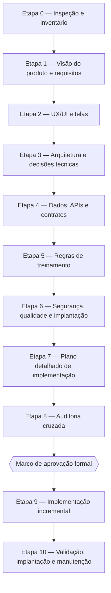

# GOV-01 — Metodologia Cascata

| Campo | Valor |
|---|---|
| Identificador | GOV-01 |
| Status | **Aprovado** (2026-10-26 — Etapa 1, revisão 3) |
| Dono do assunto | Processo de trabalho, etapas, critérios de entrada/saída, aprovações |
| Dependências | Nenhuma |
| Última atualização | 2026-10-26 |

## 1. Objetivo

Definir o processo sequencial (Waterfall) que governa o projeto: etapas, entregáveis, critérios de conclusão, marcos de aprovação e gestão de mudanças. O objetivo é impedir decisões contraditórias, requisitos inventados e implementação sem planejamento.

## 2. Fases

| Fase | Conteúdo | Situação |
|---|---|---|
| **Fase 1 — Planejamento e documentação** | Etapas 0 a 8 | **Concluída e aprovada** (2026-10-26) |
| **Fase 2 — Implementação** | Etapas 9 e 10 | **Em andamento** — Marco autorizado em 2026-10-26 |

### 2.1 Regras da Fase 1 (inegociáveis)

1. Não implementar funcionalidades.
2. Não criar componentes, páginas, APIs, migrations, tabelas, serviços, hooks ou lógica de negócio.
3. Não instalar dependências nem criar/alterar arquivos de configuração da aplicação.
4. Inspeção do repositório apenas em modo somente leitura.
5. Criar/editar somente documentos Markdown dentro de `docs/`.
6. Preservar arquivos existentes; não sobrescrever sem verificar conteúdo e relevância.
7. Não registrar decisões como aprovadas sem confirmação explícita do usuário.
8. Exemplos de contratos (JSON) e diagramas (Mermaid) são permitidos dentro dos `.md`; código executável de aplicação não.
9. Silêncio, ausência de comentários ou aprovação parcial **não** autorizam a implementação.
10. Pedido de implementação antes da aprovação integral exige confirmação explícita de que o usuário deseja, excepcionalmente, alterar o processo.

## 3. Etapas

> **Sequência oficial (ADR-001, aprovada):** esta é a única numeração de etapas válida no projeto. Qualquer outra numeração encontrada (inclusive a da seção 3 do prompt mestre original) deve ser lida conforme esta tabela.

| Etapa | Entregáveis (pasta) | Critérios de entrada | Critérios de conclusão |
|---|---|---|---|
| 0 — Inspeção | Seção "Resultado da Etapa 0" em [GOV-02](02-controle-de-progresso.md) | Nenhum | Estado do repositório documentado; conflitos identificados |
| 1 — Produto | `01-produto/*` (PRD-01..08) | Etapa 0 concluída | RF/RNF/RN identificados, testáveis, priorizados; escopo MVP delimitado; decisões de produto registradas como ADR; **aprovação do usuário** |
| 2 — UX/UI | `02-experiencia/*` | Etapa 1 aprovada | Toda tela mapeada a RFs; estados (carregando, vazio, erro, sucesso) definidos; navegação e componentes especificados; PWA especificada |
| 3 — Arquitetura | `03-arquitetura/*` | Etapa 2 concluída | Stack comparada e recomendada com ADRs; organização do repositório e padrões definidos; **aprovação da stack** |
| 4 — Dados e API | `04-dados-e-api/*` | Etapa 3 aprovada | Entidades cobrem todas as RNs; contratos cobrem todos os fluxos de tela; auth/autorização definidas; fonte do catálogo verificada (licença) |
| 5 — Regras de treinamento | `05-regras-de-treinamento/*` | Etapa 4 concluída | Motor de geração especificado de forma determinística e testável; regras de segurança/restrições explícitas |
| 6 — Segurança, qualidade e implantação | `06-seguranca-e-qualidade/*`, `07-implantacao/*` | Etapas 4 e 5 concluídas | Ameaças e controles mapeados; LGPD; estratégia de testes; offline/sincronização; backup; deploy |
| 7 — Plano | `08-planejamento/01..04` | Etapas 1–6 concluídas | Tarefas pequenas, ordenadas por dependência, cada uma com objetivo, referências, pré-requisitos, entregáveis, aceite, testes e condição de avanço |
| 8 — Auditoria | `08-planejamento/05-checklist-de-aprovacao-final.md` | Etapa 7 concluída | Matriz de rastreabilidade completa; contradições corrigidas; índice, histórico e progresso atualizados |
| **Marco** | Registro de aprovação em GOV-02 | Etapa 8 concluída | Aprovação **explícita** do usuário para iniciar a Fase 2 |
| 9 — Implementação | Código + atualizações de docs | Marco registrado | Cada tarefa `TAR-###` entregue com testes e critérios de aceite validados |
| 10 — Validação e implantação | Ambiente de produção | Etapa 9 concluída | Critérios de aceite do MVP validados em produção; backup testado |

### 3.1 Checklist antes de avançar qualquer etapa

- [x] Os documentos da etapa estão completos (sem seções "a definir" não justificadas).
- [x] As decisões necessárias estão registradas como ADR.
- [x] As dependências documentais estão resolvidas.
- [x] Não há contradição com documentos anteriores.
- [x] Os critérios de conclusão da etapa foram atendidos.
- [x] Índice, controle de progresso e histórico atualizados.

## 4. Status de documentos

| Status | Significado |
|---|---|
| Não iniciado | Arquivo existe apenas como esqueleto (objetivo e dependências). |
| Em elaboração | Conteúdo sendo escrito; pode estar incompleto. |
| Rascunho concluído | Conteúdo completo do ponto de vista do autor; revisado internamente; pode conter decisões `Proposta`. |
| Em revisão | Submetido ao usuário ou à auditoria cruzada. |
| Aprovado | Usuário aprovou explicitamente. Alterações posteriores exigem registro no histórico e reavaliação de impacto. |
| Substituído | Conteúdo superado por outro documento (indicado). |

Um documento **não** é considerado concluído apenas por ter sido criado: precisa passar pela revisão de consistência, completude e compatibilidade com os demais.

## 5. Decisões

- Toda decisão arquitetural ou de produto relevante é registrada em [ADR](../03-arquitetura/06-adrs.md).
- Status possíveis: `Proposta`, `Aprovada`, `Rejeitada`, `Substituída`.
- Uma ADR só passa a `Aprovada` com confirmação explícita do usuário, registrada no log de aprovações de [GOV-02](02-controle-de-progresso.md#6-registro-de-aprovações).
- Detalhes resolvíveis por boas práticas técnicas não geram perguntas ao usuário: são registrados como ADR `Proposta` com justificativa e entram na aprovação em lote da etapa.
- Perguntas que só o usuário pode responder (orçamento, contexto profissional etc.) são registradas como `Q-###` em GOV-02.

## 6. Gestão de mudanças

1. Toda mudança de requisito ou decisão identifica os documentos impactados (consultar a coluna "Dependências" do [índice](00-indice-documentacao.md)).
2. Os documentos impactados são atualizados na mesma rodada de trabalho.
3. Documentos já `Aprovado` que forem alterados voltam a `Em revisão` até nova aprovação, exceto correções de forma (ortografia, links).
4. A mudança é registrada em [GOV-04](04-historico-de-alteracoes.md).
5. Na Fase 2, conflitos entre código e documentação interrompem a parte afetada; propõe-se a alteração e aguarda-se aprovação quando houver impacto em escopo, arquitetura, segurança ou regras de negócio.

## 7. Padrão de conteúdo dos documentos

Cada documento contém, conforme sua finalidade: título e identificador; objetivo; escopo; conteúdo detalhado; decisões e premissas; dependências; critérios de conclusão; referências cruzadas; status de revisão; histórico relevante. Markdown legível, tabelas apenas quando agregam valor, Mermaid quando facilita o entendimento, links relativos.

## 8. Protocolo para retomar o trabalho (nova sessão)

1. Ler [GOV-02](02-controle-de-progresso.md) → "Próximo passo" e "Decisões abertas".
2. Ler os documentos da etapa corrente e suas dependências (índice).
3. Continuar de onde parou; atualizar GOV-02 ao final de cada rodada.

## Histórico

| Data | Alteração |
|---|---|
| 2026-10-26 | Criação. Reconciliação da numeração de etapas (ADR-001, proposta). |
| 2026-10-26 | Revisão 2: ADR-001 aprovada; sequência oficial única. |
| 2026-10-26 | Aprovado pelo usuário (Etapa 1, revisão 3). |
| 2026-10-26 | Fase 1 concluída; Marco autorizado; Fase 2 iniciada (registro de situação, sem mudança de processo). |
