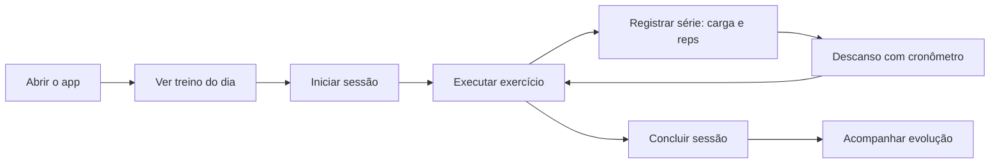

# PRD-01 — Visão do Produto

| Campo | Valor |
|---|---|
| Identificador | PRD-01 |
| Status | **Aprovado** (2026-10-26 — Etapa 1, revisão 3) |
| Dono do assunto | Propósito, proposta de valor, objetivos e métricas de sucesso |
| Dependências | GOV-03 |
| Referenciado por | PRD-02 a PRD-07, UX-01 |
| Última atualização | 2026-10-26 |

## 1. Objetivo do documento

Estabelecer o propósito do produto, para quem ele existe, o valor que entrega e como saberemos que ele funciona. Todos os demais documentos derivam desta visão.

## 2. Declaração de visão

> Um aplicativo de treinos **simples, bonito e confiável**, pensado para ser usado **no celular, dentro da academia**, que permite planejar treinos personalizados — manualmente ou com ajuda de um gerador baseado em regras — e executá-los, registrá-los e acompanhar a evolução real ao longo de meses. Começa como ferramenta de **uso pessoal** e está preparado para, futuramente e após verificação regulatória, apoiar o acompanhamento de outros alunos.

## 3. Contexto

- O produto será usado inicialmente pelo próprio idealizador, que registrará os **próprios** treinos reais durante meses. A confiabilidade dos registros é, portanto, mais importante que a quantidade de funcionalidades.
- Não se presume habilitação profissional do usuário. O acompanhamento de terceiros é uma modalidade separada, bloqueada até a verificação dos requisitos legais e regulatórios (ADR-018, [PRD-08](08-modalidades-de-uso-e-limites-profissionais.md)).
- Embora comece com um único profissional e poucos alunos, a arquitetura deve suportar vários alunos com dados isolados e permitir evolução futura (ex.: geração assistida por IA, múltiplos profissionais).
- O ambiente de uso principal — a academia — impõe restrições: tela pequena, mãos ocupadas ou suadas, pouco tempo entre séries, iluminação variável e **conectividade instável**.

## 4. Proposta de valor

| Para | Valor |
|---|---|
| **Gestão do treino** (papel técnico; na modalidade pessoal, o próprio usuário) | Monta e versiona programas personalizados rapidamente; o gerador entrega um ponto de partida coerente com o perfil real, sempre sujeito a revisão; acompanha frequência, cargas e evolução em um só lugar; é avisado quando dados ou treinos estão desatualizados. |
| **Aluno** | Abre o app e já vê o treino do dia; executa com orientações e imagens; registra séries com poucos toques; cronômetro de descanso embutido; vê sua frequência e evolução de peso e cargas. |

## 5. Fluxo principal (aluno)

## 6. Objetivos do produto

| ID | Objetivo | Indicador | Meta inicial |
|---|---|---|---|
| OBJ-01 | Registro de treino rápido e confiável | Toques para registrar uma série com valores pré-preenchidos | ≤ 2 toques |
| OBJ-02 | Nenhuma perda de registro | Séries registradas perdidas por falha de rede/fechamento do app | 0 |
| OBJ-03 | Uso contínuo real | Sessões registradas pelo usuário inicial em 3 meses | ≥ 80% das sessões realmente realizadas |
| OBJ-04 | Planejamento ágil | Tempo para montar e publicar o próprio programa com perfil completo | ≤ 15 min manualmente (Lançamento 1); ≤ 10 min com o gerador (incremento D2) |
| OBJ-05 | Acompanhamento da evolução | Reavaliações realizadas ou adiadas conscientemente | 100% sinalizadas no prazo |
| OBJ-06 | Segurança e privacidade | Acessos indevidos a dados de outro aluno/usuário | 0 (verificado por testes automatizados) |
| OBJ-07 | Uso pessoal rápido | Lançamento 1 em uso real pelo usuário | O mais cedo possível, com escopo `ESS` (PRD-04 §2) |

## 7. Princípios do produto

1. **Celular primeiro, academia primeiro.** Toda decisão de interface considera uso em pé, com uma mão, entre séries.
2. **Registro real acima de tudo.** Presença e evolução refletem o que foi efetivamente feito, não o que foi planejado.
3. **Personalização honesta.** Um treino só é apresentado como personalizado se deriva dos dados reais do aluno; o gerador explica o que considerou e o que faltou.
4. **Humano no controle.** Nenhum treino gerado automaticamente é publicado sem revisão humana.
5. **Segurança física.** Restrições declaradas são respeitadas pelo gerador; o app não diagnostica nem substitui avaliação de saúde.
6. **Privacidade por padrão.** Coleta mínima, dados de saúde tratados como sensíveis, isolamento rigoroso entre alunos.
7. **Simplicidade proporcional.** Stack, infraestrutura e funcionalidades proporcionais a um projeto pessoal com potencial de crescimento.
8. **Limites profissionais explícitos.** O app não se apresenta como prescrição profissional; o uso com terceiros depende de verificação regulatória (PRD-08).

## 8. O que o produto não é

- Não é um aplicativo de nutrição ou dieta.
- Não é uma ferramenta de diagnóstico médico ou fisioterapêutico.
- Não é uma rede social de treino.
- Não é um sistema de gestão de academia (matrículas, pagamentos, catracas).

Detalhamento de limites em [PRD-04](04-escopo-e-limites-do-mvp.md).

## 9. Horizonte de evolução (não compromete o MVP)

1. **Lançamento 1 (essencial, uso pessoal):** perfil, programa manual versionado, execução offline com sincronização, agenda, histórico, peso.
2. **Incrementos desejáveis (D1–D5):** reavaliação, gerador por regras, evolução ampliada, qualidade de dados, conveniências.
3. **Modalidade de terceiros:** somente após o GATE-TER (PRD-08).
4. **Futuro:** IA (sempre com revisão humana), notificações, fotos de progresso, integrações.

## 10. Premissas

| ID | Premissa | Validação |
|---|---|---|
| P-01 | O usuário inicial usa uma conta com papel duplo para os próprios treinos; não se presume habilitação profissional. | ADR-003, ADR-018 (aprovadas) |
| P-02 | O público inicial é adulto (≥ 18 anos). | ADR-009 |
| P-03 | A conexão na academia pode falhar; o registro de sessão não pode depender de rede contínua. | ADR-005 (aprovada) |
| P-04 | Hospedagem gratuita ou de baixo custo, sem serviço pago obrigatório não aprovado. | ADR-016 (aprovada) |

## Critérios de conclusão

- [x] Visão, proposta de valor, objetivos mensuráveis e princípios definidos.
- [x] Premissas registradas com vínculo a decisões/perguntas.
- [x] Aprovação do usuário.

## Histórico

| Data | Alteração |
|---|---|
| 2026-10-26 | Criação. |
| 2026-10-26 | Revisão 2: foco no uso pessoal, limites profissionais, OBJ-04 e OBJ-07, horizonte por lançamentos, premissas atualizadas. |
| 2026-10-26 | Aprovado pelo usuário (Etapa 1, revisão 3). |
