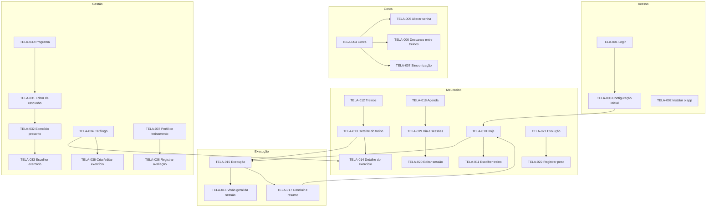

# UX-03 — Arquitetura de Informação

| Campo | Valor |
|---|---|
| Identificador | UX-03 |
| Status | **Aprovado** (2026-10-26 — Etapa 2) |
| Etapa | 2 |
| Dono do assunto | Estrutura de áreas, mapa de telas, navegação e rotas lógicas |
| Dependências | PRD-03, PRD-05, ADR-003, ADR-018 |
| Referenciado por | UX-04, UX-05, UX-06, DAD-04 |
| Decisões | ADR-025 (estrutura de navegação), ADR-026 (execução em modo foco) — aprovadas |
| Última atualização | 2026-10-26 |

## 1. Objetivo

Definir como o conteúdo se organiza: áreas, navegação principal, hierarquia de telas e rotas. As telas são identificadas por `TELA-###` e especificadas em [UX-05](05-especificacao-das-telas.md).

## 2. Áreas

| Área | Para quê | Quem | Navegação |
|---|---|---|---|
| **Meu treino** (aluno) | Executar, registrar, acompanhar | Papel aluno | Barra inferior com 5 destinos |
| **Gestão** | Montar programa, catálogo, perfil de treinamento | Papel de gestão | Barra inferior com 4 destinos |
| **Execução** | Fazer o treino | Papel aluno | Tela cheia em modo foco, sem barra inferior (ADR-026) |
| **Acesso** | Login, configuração inicial | Todos | Sem navegação |

- Usuário com papel duplo (ADR-003) entra em **Meu treino** e alterna pela **chave de área** no cabeçalho ("Meu treino ▾ / Gestão") ou em Conta (RF-005).
- Usuário só com papel de aluno (modalidade TER, futura) não vê a chave de área.

## 3. Navegação principal (ADR-025)

### 3.1 Meu treino — barra inferior (celular) / trilho lateral (≥ 1024 px)

| Ordem | Destino | Ícone | Tela |
|---|---|---|---|
| 1 | **Hoje** | `house` | TELA-010 |
| 2 | **Treinos** | `dumbbell` | TELA-012 |
| 3 | **Agenda** | `calendar-days` | TELA-018 |
| 4 | **Evolução** | `chart-line` | TELA-021 |
| 5 | **Conta** | `user` | TELA-004 |

### 3.2 Gestão

| Ordem | Destino | Ícone | Tela |
|---|---|---|---|
| 1 | **Programa** | `clipboard-list` | TELA-030 |
| 2 | **Catálogo** | `library` | TELA-034 |
| 3 | **Perfil** (de treinamento) | `id-card` | TELA-037 |
| 4 | **Conta** | `user` | TELA-004 |

Na modalidade TER (futura), "Perfil" dá lugar a "Alunos" (lista) — não especificado nesta etapa.

### 3.3 Elementos globais

| Elemento | Onde | Comportamento |
|---|---|---|
| Cabeçalho | Todas as telas, exceto Execução e Acesso | Título da tela, chave de área (papel duplo), indicador de sincronização |
| Indicador de sincronização (`SyncIndicator`) | Cabeçalho | Ícone + texto curto conforme UX-02 §4.4; toque abre TELA-007 |
| Barra de sessão em andamento (`SessionBar`) | Acima da barra inferior, em todas as telas de Meu treino e Gestão | "Treino B em andamento · 23 min · Voltar" — 1 toque retorna à execução (P1) |
| Banner de aviso | Topo do conteúdo de Hoje | Reavaliação (D1), dados desatualizados (D4), pendências antigas (UX-08 §7) |

## 4. Mapa de telas

Prioridade conforme PRD-04; `D#` indica o incremento desejável.

### 4.1 Inventário de telas

| ID | Tela | Área | Prior. | RF principais |
|---|---|---|---|---|
| TELA-001 | Login | Acesso | ESS | RF-001 |
| TELA-002 | Instalar o app | Acesso/Conta | ESS | RF-090 |
| TELA-003 | Configuração inicial | Acesso | ESS | RF-009 |
| TELA-004 | Conta | Conta | ESS | RF-002, RF-005, RF-007, RF-101, RF-102, RF-103 |
| TELA-005 | Alterar senha | Conta | ESS | RF-007 |
| TELA-006 | Descanso entre treinos | Conta | ESS | RF-055 |
| TELA-007 | Sincronização | Conta | ESS | RF-092, RF-100 |
| TELA-010 | Hoje | Meu treino | ESS | RF-050, RF-051 |
| TELA-011 | Escolher treino | Meu treino | ESS | RF-051 |
| TELA-012 | Treinos | Meu treino | ESS | RF-052 |
| TELA-013 | Detalhe do treino | Meu treino | ESS | RF-053 |
| TELA-014 | Detalhe do exercício | Meu treino/Gestão | ESS | RF-031, RF-054 |
| TELA-015 | Execução | Execução | ESS | RF-060..063, RF-066, RF-067, RF-091 |
| TELA-016 | Visão geral da sessão | Execução | ESS | RF-063, RF-066 |
| TELA-017 | Concluir e resumo | Execução | ESS | RF-065 |
| TELA-018 | Agenda | Meu treino | ESS | RF-070, RF-071 |
| TELA-019 | Dia e sessões | Meu treino | ESS | RF-072 |
| TELA-020 | Editar sessão | Meu treino | ESS | RF-069 |
| TELA-021 | Evolução | Meu treino | ESS | RF-081 |
| TELA-022 | Registrar peso | Meu treino | ESS | RF-080 |
| TELA-030 | Programa | Gestão | ESS | RF-025, RF-027, RF-028, RF-093 |
| TELA-031 | Editor de rascunho | Gestão | ESS | RF-020, RF-024, RF-025 |
| TELA-032 | Exercício prescrito | Gestão | ESS | RF-020, RF-024 |
| TELA-033 | Escolher exercício | Gestão | ESS | RF-030 |
| TELA-034 | Catálogo | Gestão | ESS | RF-030, RF-031 |
| TELA-036 | Criar/editar exercício | Gestão | ESS | RF-032 |
| TELA-037 | Perfil de treinamento | Gestão | ESS | RF-012 |
| TELA-038 | Registrar avaliação | Gestão | ESS | RF-016 |
| TELA-050 | Reavaliação | Meu treino | DES (D1) | RF-083..085 |
| TELA-051 | Gerar treino | Gestão | DES (D2) | RF-021..023 |
| TELA-052 | Histórico do exercício | Meu treino | DES (D3) | RF-073 |
| TELA-053 | Metas | Meu treino | DES (D3) | RF-082 |
| TELA-054 | Medidas corporais | Meu treino | DES (D3) | RF-088 |
| TELA-055 | Histórico de avaliações | Gestão | DES (D3) | RF-017 |
| TELA-056 | Versões do programa | Gestão | DES (D4) | RF-026 |
| TELA-057 | Registrar treino realizado | Meu treino | DES (D5) | RF-068 |
| TELA-058 | Substituir exercício | Execução | DES (D5) | RF-064 |
| TELA-059 | Exportar meus dados | Conta | DES (D5) | RF-095 |

Faixa TELA-070 a TELA-089 reservada para a modalidade TER (não especificada). Requisitos `DES` sem tela própria (RF-015, RF-018, RF-033, RF-035, RF-036, RF-086, RF-087) são atendidos por elementos em telas existentes — ver UX-05 §6.

## 5. Rotas lógicas

Rotas são **lógicas** (a sintaxe final depende da stack, Etapa 3). Regra: **nenhum dado pessoal em URLs** (RNF-017) — apenas identificadores opacos e datas de calendário.

| Rota | Tela |
|---|---|
| `/entrar` | TELA-001 |
| `/configuracao-inicial` | TELA-003 |
| `/hoje` (inicial da área aluno) | TELA-010 |
| `/treinos`, `/treinos/{id}` | TELA-012, TELA-013 |
| `/exercicios/{id}` | TELA-014 |
| `/sessao` (sessão em andamento) | TELA-015/016 |
| `/sessao/concluir` | TELA-017 |
| `/agenda?mes=AAAA-MM`, `/agenda/{AAAA-MM-DD}` | TELA-018, TELA-019 |
| `/sessoes/{id}/editar` | TELA-020 |
| `/evolucao` | TELA-021 |
| `/conta`, `/conta/senha`, `/conta/descanso`, `/conta/sincronizacao`, `/conta/instalar` | TELA-004..007, TELA-002 |
| `/gestao/programa`, `/gestao/programa/rascunho` | TELA-030, TELA-031 |
| `/gestao/catalogo`, `/gestao/catalogo/novo`, `/gestao/catalogo/{id}/editar` | TELA-034, TELA-036 |
| `/gestao/perfil`, `/gestao/perfil/avaliacao` | TELA-037, TELA-038 |

Folhas inferiores (TELA-011, 022, 032, 033) não têm rota própria; o botão "voltar" do sistema as fecha.

## 6. Regras de navegação

1. **Voltar** do sistema/navegador sempre funciona e nunca descarta dados: rascunhos de formulário são preservados ou é exibida confirmação (P6).
2. Sair da Execução (botão "minimizar") **não** encerra a sessão; ela continua em andamento e a `SessionBar` aparece (RF-066).
3. Abrir o app com sessão em andamento leva diretamente à Execução (P1).
4. Primeiro acesso sem perfil configurado → TELA-003; sem programa publicado → TELA-010 em estado vazio orientando para Gestão.
5. Telas que exigem conexão (Gestão, alterar senha) abrem offline em modo leitura quando houver cache, com ações desabilitadas e explicação (RF-093).

## Critérios de conclusão

- [x] Todas as telas `ESS` mapeadas a RFs; `DES` inventariadas.
- [x] Navegação por área, elementos globais e rotas definidos.
- [x] ADR-025 e ADR-026 aprovadas.
- [x] Aprovação do usuário.

## Histórico

| Data | Alteração |
|---|---|
| 2026-10-26 | Esqueleto criado. |
| 2026-10-26 | Conteúdo completo (Etapa 2). |
| 2026-10-26 | Aprovado pelo usuário (Etapa 2). |
| 2026-10-26 | Correção da auditoria final (Etapa 8): referências de RF-093, RF-102 e RF-103 no inventário de telas. |
