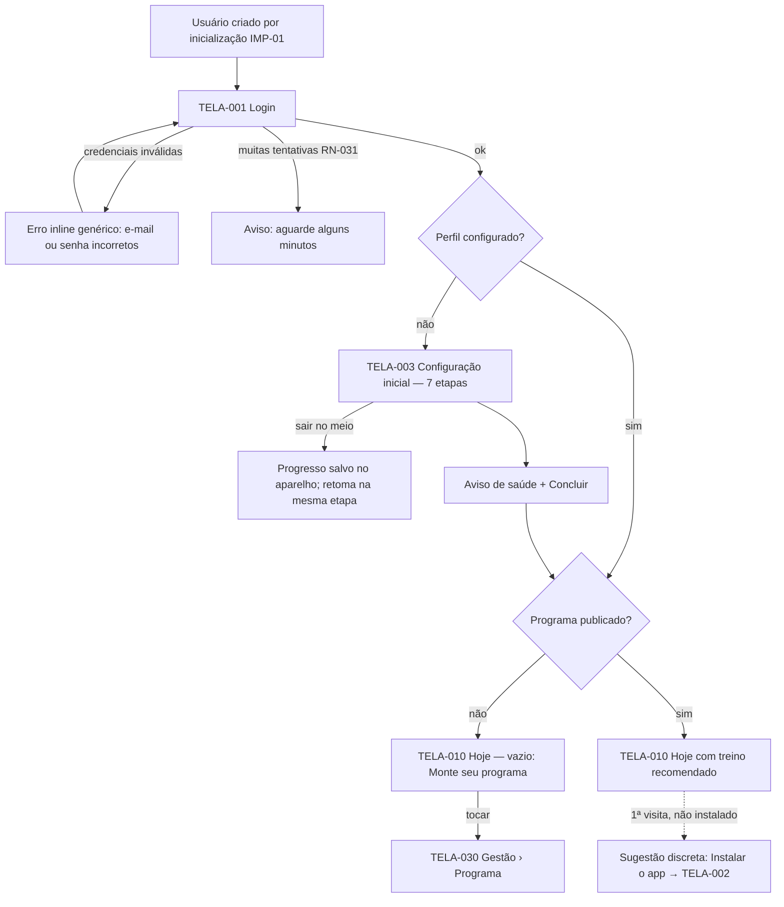
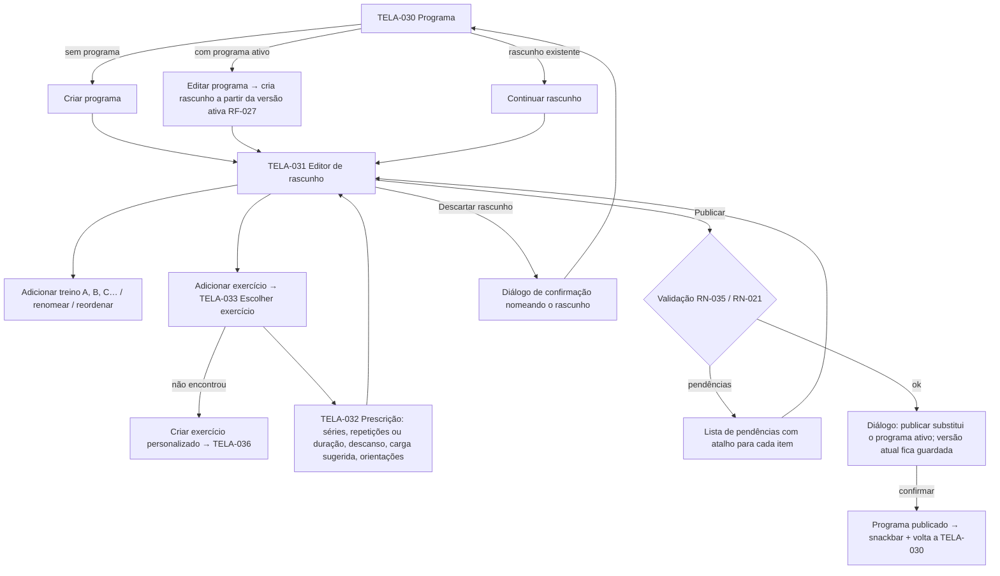
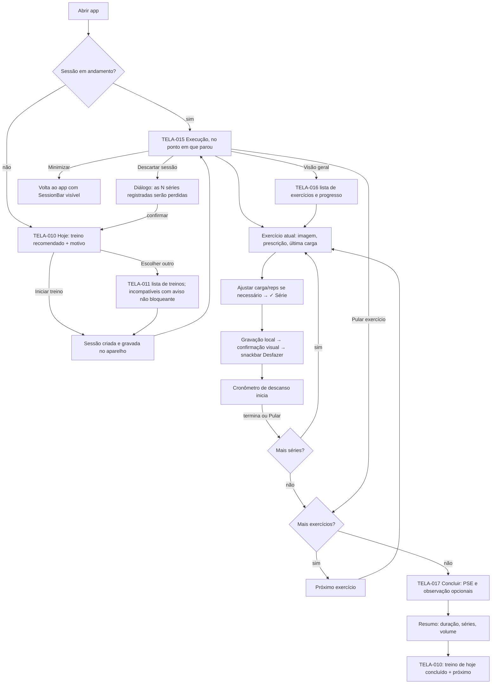
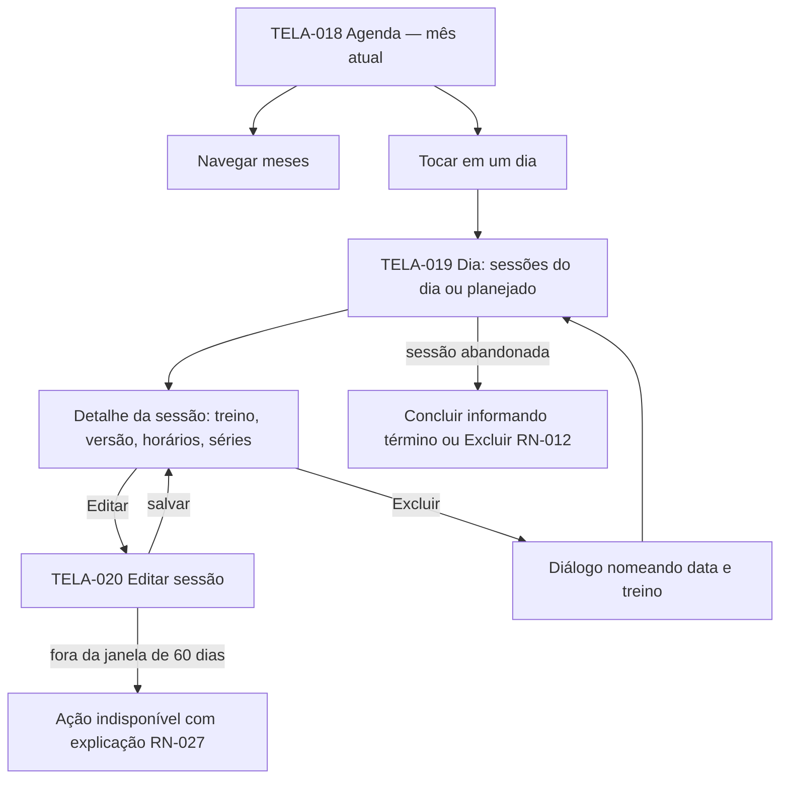
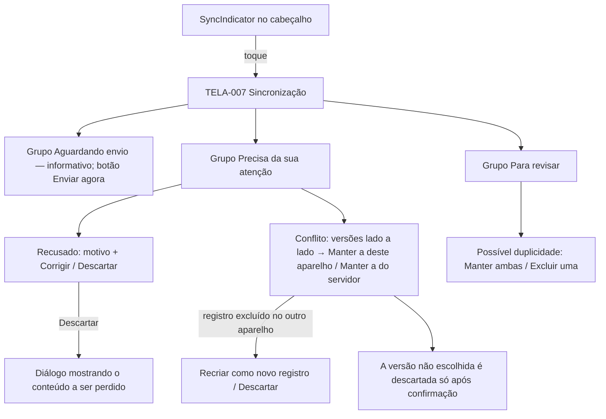
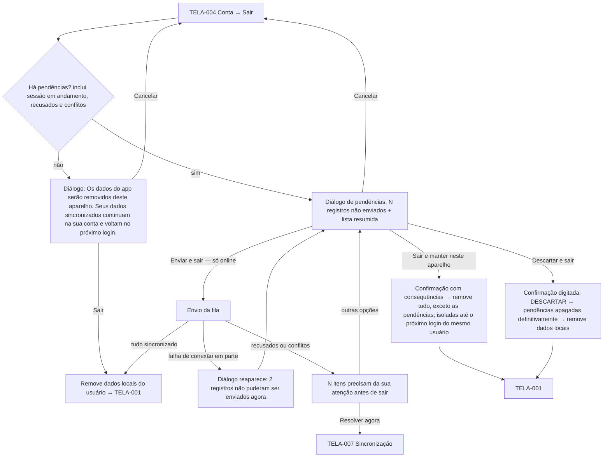
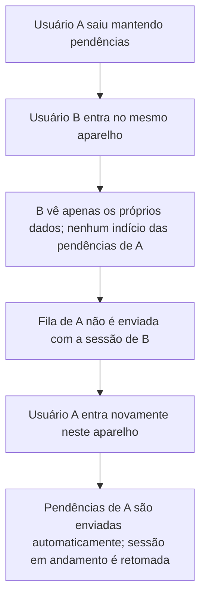
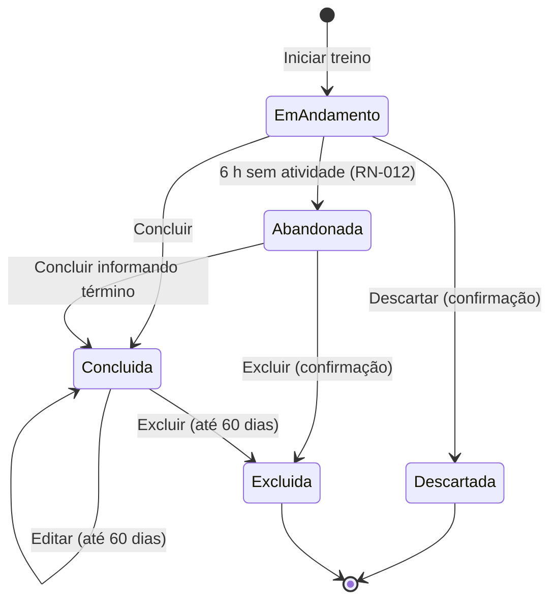

# UX-04 — Fluxos de Navegação

| Campo | Valor |
|---|---|
| Identificador | UX-04 |
| Status | **Aprovado** (2026-10-26 — Etapa 2) · detalhamento da saída da conta confirmado em 2026-10-26 |
| Etapa | 2 |
| Dono do assunto | Fluxos tela a tela das jornadas, pontos de decisão, estados de erro e fluxos offline |
| Dependências | PRD-03, PRD-07, UX-03 |
| Referenciado por | UX-05, PLN-03 (testes E2E) |
| Última atualização | 2026-11-04 (versão 1.2) |

## 1. Objetivo

Descrever, para cada jornada do Lançamento 1 (PRD-03), a sequência de telas, decisões e desvios (erro, offline). Os fluxos servem de roteiro para os testes ponta a ponta (PLN-03). Nomes de telas: [UX-03 §4.1](03-arquitetura-de-informacao.md#41-inventário-de-telas).

## 2. JOR-08 — Primeiro acesso pessoal

Notas:
- A sugestão de instalação aparece uma vez, como banner dispensável; nunca como modal.
- **Versão 1.2 (planejada, ainda não implementada — [PLN-06](../08-planejamento/06-plano-versao-1-2.md)):** no modo Automático, a configuração inicial termina na rotina proposta, com motivos e o aviso de RN-030. "Usar esta rotina" publica e leva a Hoje; a pessoa pode pedir outra (ADR-095).
- A configuração inicial exige conexão para o envio final; se offline, o botão "Concluir" explica que é preciso conexão e os dados permanecem no aparelho.

## 3. JOR-02 — Montagem do programa (manual)

Notas:
- O editor salva o rascunho automaticamente no servidor a cada alteração (com indicação "Salvo às 14:32"); offline, o editor fica em modo leitura (RF-093).
- No desktop, TELA-031 mostra lista de treinos à esquerda e exercícios do treino selecionado à direita.

## 4. JOR-03 — Treino na academia (online e offline)

### 4.1 Desvios de conexão durante a execução

| Situação | O que o usuário vê | Comportamento |
|---|---|---|
| Sem conexão ao abrir | Indicador "Sem conexão"; Hoje mostra treino recomendado calculado localmente e "Disponível offline · atualizado às …" | Execução idêntica à online (RF-091) |
| Programa nunca carregado neste aparelho | Estado vazio: "Conecte-se uma vez para baixar seu programa para uso offline" | Sem execução possível (limitação de ADR-005) |
| Conexão cai no meio | Nada muda na execução; indicador passa a "Sem conexão" | Séries vão para a fila local |
| Conexão volta | Indicador "Enviando…" → "Sincronizado" | Envio automático (UX-08 §6) |
| Login expirado offline | Execução continua; após concluir: "Entre novamente para enviar seus treinos" | Pendências mantidas (RN-047) |
| App vai para segundo plano durante o descanso | Ao voltar, cronômetro mostra o tempo correto | Calculado pelo horário de término (RF-062) |
| App é fechado pelo sistema | Ao reabrir, Execução retoma no ponto exato | Estado persistido localmente (RF-066) |

## 5. JOR-04 — Agenda e detalhe

## 6. JOR-09 — Sincronização e pendências

### 6.1 Saída da conta (RF-101, RF-103, RN-052)

#### Textos das opções (consequências explícitas)

| Opção | Disponível | Texto de consequência |
|---|---|---|
| **Enviar e sair** (primária) | Somente online | "Vamos enviar seus registros e depois sair. Se algo não puder ser enviado, você decide o que fazer." |
| **Sair e manter neste aparelho** | Sempre (pede a senha — ADR-028) | "Para proteger seus registros, confirme sua senha. Seus N registros não enviados ficam guardados e criptografados neste aparelho e serão enviados quando você entrar de novo nele. Outras pessoas que usarem o app neste aparelho não poderão vê-los, mas eles continuam armazenados aqui. Se você não voltar a entrar neste aparelho, eles não chegarão à sua conta." |
| **Descartar e sair** (perigo) | Sempre | "**Esta ação é irreversível.** Os N registros abaixo serão apagados para sempre deste aparelho e não chegarão à sua conta: \<lista\>. Digite DESCARTAR para confirmar." |
| **Cancelar** | Sempre | — |

Offline, **Enviar e sair** aparece desabilitado com a explicação "Sem conexão — conecte-se para enviar antes de sair".

### 6.2 Troca de usuário no mesmo aparelho

### 6.3 Sessão de acesso expirada ou revogada

Não é uma saída: nenhum dado local é removido. O app pede novo login; se for o **mesmo** usuário, tudo continua (RN-052 d). Se outra pessoa entrar, aplica-se §6.2.

## 7. Ciclo de vida da sessão (visão de interface)

O estado de **sincronização** (RN-051) é independente do ciclo de vida acima: qualquer estado pode estar "aguardando envio".

## 8. Fluxos dos incrementos `DES` (resumo)

| Incremento | Fluxo |
|---|---|
| D1 Reavaliação | Banner em Hoje → TELA-050 (peso, medidas opcionais, confirmar/alterar objetivo, disponibilidade, preferências, equipamentos, restrições) → salvar; ou "Lembrar em…" com seletor de data (sugestão +7 dias). Mudança relevante → banner "Revisão recomendada" em Gestão › Programa. |
| D2 Gerador | Gestão › Programa → "Gerar treino automaticamente" → verificação de pendências (atalhos para Perfil) → rascunho com premissas e exclusões → Editor → Publicar. |
| D3–D5 | Acesso a partir de Evolução, Detalhe do exercício, Agenda (dia sem registro → "Registrar treino realizado") e Conta (exportar). |

## Critérios de conclusão

- [x] Fluxos de todas as jornadas `ESS` com desvios de erro e offline.
- [x] Ciclo de vida da sessão e fluxo de pendências.
- [x] Aprovação do usuário.

## Histórico

| Data | Alteração |
|---|---|
| 2026-10-26 | Esqueleto criado. |
| 2026-10-26 | Conteúdo completo (Etapa 2). |
| 2026-10-26 | Aprovado pelo usuário (Etapa 2); seções de saída da conta detalhadas conforme condição da UXP-02. |
| 2026-10-26 | Texto de irreversibilidade no descarte; confirmação de senha em "Sair e manter" (ADR-028). |
| 2026-10-26 | Detalhamento da saída da conta e isolamento confirmado pelo usuário. |
| 2026-11-04 | Versão 1.2: fluxo do modo Automático. |
