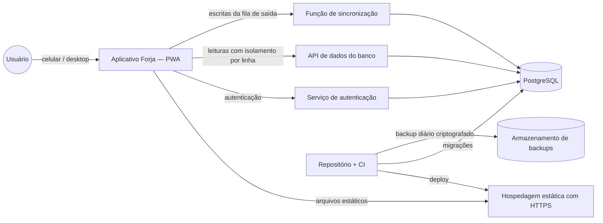

# ARQ-01 — Arquitetura Geral

| Campo | Valor |
|---|---|
| Identificador | ARQ-01 |
| Status | **Aprovado** (2026-10-26 — Etapa 3) |
| Etapa | 3 |
| Dono do assunto | Visão de componentes, camadas, fluxos técnicos e localização das regras de negócio |
| Dependências | PRD-05, PRD-06, PRD-07, UX-08, ADR-005, ADR-016, ADR-017, ADR-027, ADR-028 |
| Referenciado por | ARQ-02..05, DAD-01..07, SEG-01, IMP-01..04, PLN-01 |
| Decisões | ADR-030 (estilo arquitetural), ADR-034 (escritas por função de sincronização) — aprovadas |
| Última atualização | 2026-10-26 |

## 1. Objetivo

Descrever como o sistema é dividido, onde cada responsabilidade fica e como os dados circulam — online e offline — de forma compatível com as decisões aprovadas (offline com fila de saída, isolamento por usuário, custo baixo). As tecnologias concretas estão em [ARQ-02](02-stack-tecnologica.md).

## 2. Estilo arquitetural (ADR-030)

**Aplicação web progressiva "offline-first" + backend gerenciado (BaaS) sobre PostgreSQL.**

- O **aplicativo no navegador** contém a interface, as regras de domínio necessárias offline (recomendação, validações de entrada, classificação de sincronização) e o armazenamento local com fila de saída (ADR-027).
- O **backend gerenciado** oferece autenticação, banco relacional com **isolamento por linha** e uma **função de sincronização** que recebe as escritas, valida as regras e aplica a idempotência (ADR-034).
- Não há servidor próprio para manter (sem máquina virtual), o que atende à ADR-016 (custo) e reduz a operação.

Alternativas descartadas (detalhe em ADR-030): servidor monolítico próprio em VPS; aplicação renderizada no servidor; banco de documentos com sincronização automática de terceiros (conflita com ADR-027).

## 3. Contexto



## 4. Componentes

### 4.1 No aparelho (PWA)

| Componente | Responsabilidade | Referências |
|---|---|---|
| **Interface** | Telas e componentes (UX-05/06), temas, acessibilidade | UX-* |
| **Domínio** (pacote puro, sem acesso a rede ou armazenamento) | Recomendação do treino (RN-013, RN-050), validação de faixas (RN-018, RN-035), cálculo de duração estimada, volume, progresso (RN-017), classificação de respostas de sincronização (RN-051), motor de geração (D2) | ARQ-04 §3 |
| **Armazenamento local** | Banco local por usuário (L1 da ADR-028) com os conjuntos de UX-08 §6.2 | ADR-027, ADR-028 |
| **Fila de saída e motor de envio** | Registrar operações com identificador e dono; enviar respeitando ordem, guardas (L3) e intervalos; classificar resultados | RN-042..053, UX-08 §6.3 |
| **Sessão de acesso** | Guardar e renovar a sessão; detectar expiração; nunca remover dados ao expirar | RN-052 d |
| **Service worker** | Pacote do app e imagens do catálogo em cache; **nunca** dados pessoais (L5) | UX-08 §6.1 |
| **Proteção de pendências mantidas** | Criptografar/descriptografar com chave derivada da senha (L6) | ADR-028 |

### 4.2 No backend gerenciado

| Componente | Responsabilidade |
|---|---|
| **Autenticação** | Login por e-mail e senha, sessões, hash de senha (RNF-013); usuário inicial criado por procedimento operacional (ADR-004) |
| **Banco PostgreSQL** | Fonte de verdade; restrições de integridade como rede de segurança; políticas de isolamento por linha (L4) para **todas** as tabelas com dados de aluno |
| **API de dados** | Leituras autenticadas, sempre sujeitas às políticas por linha |
| **Função de sincronização** | Única porta de **escrita** de dados do aluno e da gestão: autentica pela sessão, valida com o mesmo pacote de domínio, aplica idempotência, controle de revisão (conflitos), regras de RN e o bloqueio TER (RN-040); executa com as permissões do usuário, nunca com credencial administrativa |

### 4.3 Fora do produto

| Componente | Responsabilidade |
|---|---|
| Repositório e CI | Código, testes, build, deploy, migrações |
| Backup | Cópia diária do banco, criptografada, fora do provedor do banco (ADR-036) |

## 5. Onde vivem as regras de negócio

Princípio: **o servidor revalida tudo** (PRD-07 §1); o aparelho aplica as regras necessárias offline usando o **mesmo código de domínio**, para que online e offline tenham o mesmo resultado.

| Regras | Aparelho | Função de sincronização | Banco (restrições/políticas) |
|---|---|---|---|
| RN-001, RN-002, RN-033, RN-040 (acesso, papéis, gate TER) | Navegação e ocultação | **Verificação obrigatória** | **Políticas por linha** |
| RN-003, RN-004, RN-005, RN-021, RN-035 (programas) | Validação no editor | **Validação na publicação** | Unicidade (um ativo, um rascunho), imutabilidade de versões publicadas |
| RN-006..009, RN-022, RN-023 (geração, D2) | Motor de geração (pacote de domínio) | Validação do rascunho resultante (RN-007) | Referências a exercícios existentes |
| RN-011..013, RN-026, RN-029, RN-038, RN-049, RN-050 (presença, recomendação) | **Cálculo** (online e offline) | — (não depende do servidor) | — |
| RN-012, RN-027, RN-044..048 (sessões, sincronização) | Aplicação local | **Aplicação e decisão final** | Chaves únicas por identificador do aparelho |
| RN-014..017 (reavaliação, evolução) | Cálculo para exibição | Validação de registros | Faixas (RN-018) como restrição |
| RN-018 (faixas) | Validação de entrada | Validação | Restrições de faixa |
| RN-031, RN-032 (senha, links) | Validação de formulário | — | Serviço de autenticação (ver verificação VH-04/VH-05 em ARQ-02) |
| RN-036, RN-037 (catálogo) | — | Validação na edição | Origem obrigatória |
| RN-051..053 (estados, saída, isolamento) | **Implementação** | Guarda de dono (L4) | Políticas por linha |

## 6. Fluxos técnicos

### 6.1 Leitura (online)

1. O app solicita dados à API de dados com a sessão do usuário.
2. As políticas por linha garantem que só os dados do usuário retornem.
3. O app grava a resposta no banco local do usuário (sem passar pelo cache do service worker) e atualiza a tela.

### 6.2 Escrita (online ou offline)

```mermaid
sequenceDiagram
    participant UI as Interface
    participant LOC as Banco local (usuário)
    participant Q as Fila de saída
    participant S as Função de sincronização
    participant DB as PostgreSQL
    UI->>LOC: grava o registro (RN-043)
    UI->>Q: operação {id, dono, tipo, revisão base}
    UI-->>UI: confirmação visual
    Q->>Q: guarda L3: dono == usuário da sessão?
    Q->>S: envia em ordem (quando houver conexão)
    S->>S: usuário pela sessão; dono confere (L4)
    S->>S: idempotência pelo id (RN-042); validação (pacote de domínio)
    S->>DB: aplica com as permissões do usuário (políticas por linha)
    S-->>Q: aceito | recusado(motivo) | conflito(versão atual)
    Q->>LOC: atualiza estado (RN-051)
```

### 6.3 Publicação de programa e geração

Exigem conexão (RF-093). A publicação é uma operação única na função de sincronização: valida RN-035/RN-021, arquiva a versão ativa e cria a nova versão imutável numa só transação.

### 6.4 Login, saída e troca de usuário

- **Login:** serviço de autenticação → sessão guardada → abertura do banco local do usuário (L1) → se houver pendências mantidas criptografadas desse usuário, a senha digitada libera-as (L6) e o envio começa.
- **Saída:** fluxo RN-052 (UX-04 §6.1); limpeza remove o banco local do usuário, exceto pendências mantidas e criptografadas.
- **Troca de usuário:** fecha tudo em memória e abre somente o banco do novo usuário.

### 6.5 Atualização do app

Conforme UX-08 §9: download em segundo plano; ativação apenas sem sessão em andamento; migração do banco local preservando a fila.

## 7. Requisitos não funcionais atendidos pela arquitetura

| RNF | Como |
|---|---|
| RNF-006, RNF-007 | Pacote estático em CDN; escrita local primeiro |
| RNF-009 | Serviços gerenciados; dependência da disponibilidade do provedor e da pausa do plano gratuito após 1 semana sem uso (ARQ-02 §7) |
| RNF-010 | Fila de saída persistente + idempotência + conflitos explícitos |
| RNF-011 | Backup próprio diário (ADR-036) |
| RNF-012..017 | HTTPS; hash de senha do serviço de autenticação; isolamento por linha; função de sincronização com validação; nenhum dado pessoal em URLs, logs ou caches |
| RNF-020, RNF-021 | TypeScript estrito de ponta a ponta; pacote de domínio puro e testável |
| RNF-023 | Camadas gratuitas (ARQ-02 §6) |
| RNF-024 | Modelo multi-aluno com vínculo ao gestor desde o início |

## 8. Fora do escopo desta arquitetura

- Execução de lógica em segundo plano com o app fechado (ADR-017).
- Envio de e-mails e notificações push (fora do Lançamento 1).
- Servidores ou máquinas virtuais próprios.

## Critérios de conclusão

- [x] Componentes, responsabilidades e fluxos definidos, coerentes com ADR-005, 016, 017, 027 e 028.
- [x] Localização de cada grupo de regras definida.
- [x] ADR-030 e ADR-034 aprovadas.
- [x] Aprovação do usuário.

## Histórico

| Data | Alteração |
|---|---|
| 2026-10-26 | Esqueleto criado. |
| 2026-10-26 | Conteúdo completo (Etapa 3). |
| 2026-10-26 | RNF-009 com risco de pausa confirmado. |
| 2026-10-26 | Aprovado pelo usuário (Etapa 3). |
