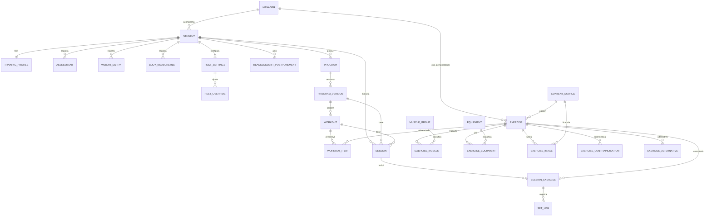
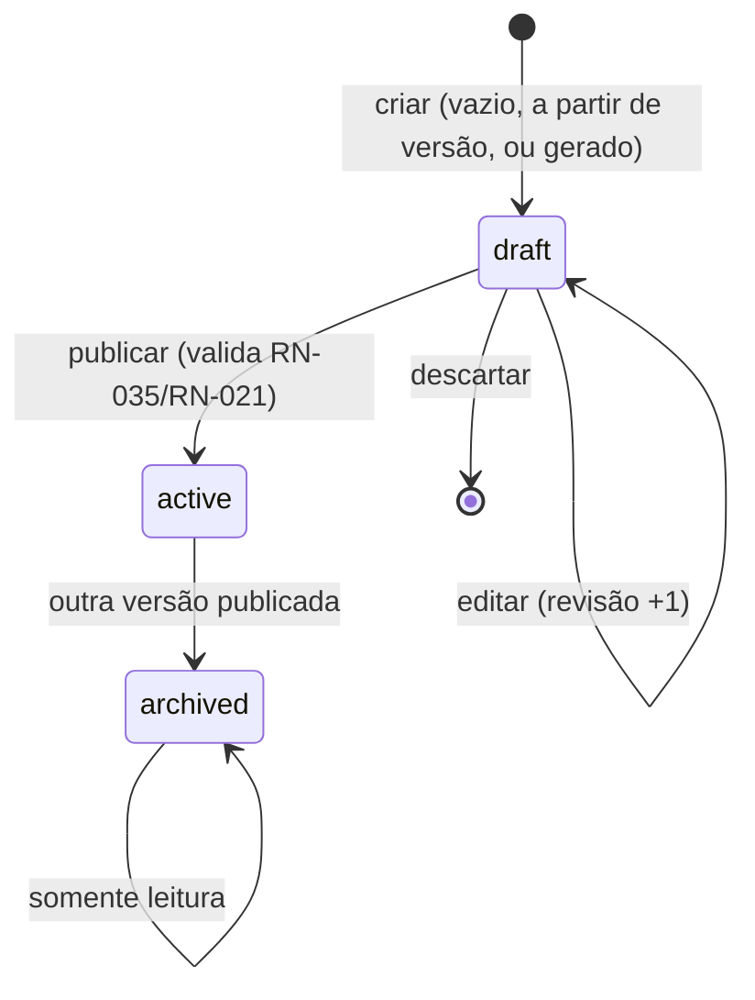

# DAD-01 — Modelagem de Dados

| Campo | Valor |
|---|---|
| Identificador | DAD-01 |
| Status | **Aprovado** (2026-10-26 — Etapa 4) |
| Etapa | 4 |
| Dono do assunto | Modelo conceitual e lógico: entidades (ENT-###), responsabilidades, versionamento, histórico e modelo local do aparelho |
| Dependências | PRD-05, PRD-07, ARQ-01, ARQ-04 §4, ADR-002, ADR-027, ADR-028, ADR-034 |
| Referenciado por | DAD-02..07, TRN-*, SEG-02, PLN-01 |
| Decisões | ADR-053 (revisões e marcas de exclusão) — aprovada |
| Última atualização | 2026-10-26 |

## 1. Objetivo

Definir as entidades que sustentam todos os requisitos aprovados (PRD-05) e regras (PRD-07), no servidor (PostgreSQL) e no aparelho (banco local). Campos e tipos detalhados: [DAD-02](02-dicionario-de-dados.md); chaves, restrições e políticas: [DAD-03](03-relacionamentos-e-integridade.md).

## 2. Princípios de modelagem

1. **Vínculo ao gestor desde já** (ADR-002): todo aluno pertence a um gestor; na modalidade PES, gestor e aluno são o mesmo usuário (ADR-003).
2. **Versões imutáveis** (RN-004): uma versão publicada nunca é alterada; rascunho é uma versão com estado `draft`.
3. **Histórico preservado**: avaliações, pesos e sessões nunca são sobrescritos por novos registros; registros sincronizáveis usam **revisão** e **marca de exclusão** (ADR-053).
4. **Identificadores gerados no aparelho** para tudo que pode ser criado offline (RN-042); UUID em todas as tabelas.
5. **Taxonomias como tabelas de referência** (grupos musculares, equipamentos, categorias de restrição, objetivos…), com códigos estáveis; o conteúdo final é definido em TRN-01/TRN-03 (Etapa 5).
6. **Datas/horas em UTC** (`timestamptz`); datas de calendário (`date`) apenas quando o dado é um dia (avaliação, peso).

## 3. Diagrama entidade-relacionamento

## 4. Entidades

### 4.1 Pessoas e papéis

| ID | Entidade (tabela) | Responsabilidade | RF/RN |
|---|---|---|---|
| ENT-001 | Gestor (`managers`) | Papel de gestão de um usuário do serviço de autenticação | RN-002, ADR-002 |
| ENT-002 | Aluno (`students`) | Dados cadastrais do aluno, vínculo ao gestor e ao usuário; `is_self` indica o próprio gestor (PES) | RF-009, RF-012, RN-010, RN-033, RN-040 |
| ENT-003 | Perfil de treinamento (`training_profiles`) | Estado **atual** do perfil (objetivo, experiência, disponibilidade, equipamentos, restrições, preferências, peso-meta), 1:1 com aluno | RF-009, RF-012, RN-006, RN-025 |

### 4.2 Avaliação e evolução

| ID | Entidade | Responsabilidade | RF/RN |
|---|---|---|---|
| ENT-004 | Avaliação (`assessments`) | Registro datado com peso e **fotografia do perfil** naquele momento (para histórico e comparação) | RF-016, RF-017, RF-084, RN-014 |
| ENT-005 | Registro de peso (`weight_entries`) | Peso avulso ou derivado de avaliação; base do peso atual | RF-080, RF-081, RN-017 |
| ENT-006 | Medidas corporais (`body_measurements`) | Circunferências e % de gordura informado (D3) | RF-088, ADR-010 |
| ENT-007 | Adiamento de reavaliação (`reassessment_postponements`) | Cada adiamento com a nova data escolhida (D1) | RF-085, RN-015 |
| ENT-008 | Configuração de descanso (`rest_settings`) | Valor padrão (48 h inicial) | RF-055, RN-050 |
| ENT-009 | Ajuste de descanso (`rest_overrides`) | Valor por grupo muscular | RF-055, RN-050 |

### 4.3 Catálogo

| ID | Entidade | Responsabilidade | RF/RN |
|---|---|---|---|
| ENT-010 | Fonte de conteúdo (`content_sources`) | Origem, licença e atribuição de dados e imagens | RN-036, RN-037, RNF-027 |
| ENT-011 | Exercício (`exercises`) | Item do catálogo: importado (global) ou personalizado (de um gestor); ativo/inativo; textos em pt-BR; correção registrada | RF-030..038 |
| ENT-012 | Grupo muscular (`muscle_groups`) | Taxonomia (TRN-03) | RN-050 |
| ENT-013 | Músculo do exercício (`exercise_muscles`) | Papel primário/secundário | RN-013, RN-050 |
| ENT-014 | Equipamento (`equipment`) e uso (`exercise_equipment`) | Taxonomia e associação | RN-008 |
| ENT-015 | Imagem do exercício (`exercise_images`) | Arquivo, ordem, fonte e licença | RN-036 |
| ENT-016 | Contraindicação (`exercise_contraindications`) | Exercício × categoria de restrição (D2) | RF-035, RN-008 |
| ENT-017 | Alternativa (`exercise_alternatives`) | Pares de exercícios equivalentes (D4) | RF-036, RF-064 |

### 4.4 Programas

| ID | Entidade | Responsabilidade | RF/RN |
|---|---|---|---|
| ENT-018 | Programa (`programs`) | Agrupa as versões de programa de um aluno | RF-020 |
| ENT-019 | Versão do programa (`program_versions`) | Estado `draft`/`active`/`archived`; número da versão; origem manual/gerada; marca de revisão recomendada | RN-003, RN-004, RN-005, RN-009, RN-025 |
| ENT-020 | Treino (`workouts`) | Treino da versão, com posição na sequência planejada | RN-013, RN-035 |
| ENT-021 | Exercício prescrito (`workout_items`) | Exercício + prescrição | RN-035 |

### 4.5 Execução

| ID | Entidade | Responsabilidade | RF/RN |
|---|---|---|---|
| ENT-022 | Sessão (`sessions`) | Execução de um treino de uma versão: estado, horários, PSE, observação, marcas (possível duplicidade, horário suspeito), revisão | RF-060..069, RN-011, RN-012, RN-027, RN-044..049 |
| ENT-023 | Exercício da sessão (`session_exercises`) | Exercício executado/pulado na sessão (cópia da referência à prescrição) | RF-063, RF-064 |
| ENT-024 | Série registrada (`set_logs`) | Carga, repetições ou duração de cada série | RF-061, RN-018, RN-026 |

### 4.6 Infraestrutura de sincronização e operação

| ID | Entidade | Responsabilidade | RF/RN |
|---|---|---|---|
| ENT-025 | Operação recebida (`sync_operations`) | Registro de idempotência: identificador da operação, usuário, resultado (retido 90 dias) | RN-042 |
| ENT-026 | Evento de auditoria (`audit_events`) | Eventos de segurança e exclusões definitivas, sem dados pessoais | RN-020, SEG-01 |
| ENT-027 | Relato de erro do app (`client_error_reports`) | Diagnóstico técnico sem dados pessoais, retido 30 dias | ADR-038 |
| ENT-028 | Configuração do sistema (`system_settings`) | Chaves como `ter_enabled = false` (GATE-TER) | RN-040 |

Reservados: ENT-029 (consentimento — TER), ENT-030 a ENT-039 (TER e incrementos futuros).

## 5. Versionamento de programas

- No máximo uma versão `active` e uma `draft` por aluno (RN-003).
- Publicar é atômico: a versão `active` atual vira `archived`, o rascunho vira `active` com `published_at` e o próximo número de versão.
- Um gatilho no banco impede alterar `workouts`/`workout_items` de versões não-rascunho (RN-004).

## 6. Revisões e marcas de exclusão (ADR-053)

Entidades editáveis por sincronização (`sessions`, `session_exercises`, `set_logs`, `weight_entries`, `training_profiles`, `rest_settings`, `rest_overrides`, `program_versions` em rascunho) têm:

- `revision` (inteiro, incrementado pelo servidor a cada alteração aceita) — base da detecção de conflito (RN-046);
- `deleted_at` (marca de exclusão) para sessões, séries e pesos: ao excluir, os valores pessoais são apagados e restam apenas identificador, dono, `deleted_at` e `revision`, permitindo reconhecer "registro excluído em outro aparelho" (ADR-022). Marcas de exclusão são removidas definitivamente após 90 dias.

## 7. Modelo local (aparelho)

Um banco local **por usuário** (ADR-028 L1), nome derivado de identificador opaco.

| Conjunto local | Conteúdo | Origem |
|---|---|---|
| `profile`, `rest` | Cópia do perfil e do descanso | Servidor + alterações locais |
| `program` | Versão ativa completa (treinos, itens, exercícios referenciados, metadados de imagem) | Servidor |
| `catalog_cache` | Exercícios vistos e os do programa ativo | Servidor |
| `sessions`, `session_exercises`, `set_logs` | Últimos 90 dias + sessão em andamento | Servidor + locais |
| `weights` | Últimos 12 meses | Servidor + locais |
| `last_execution` | Última execução por exercício do programa ativo | Derivado |
| `outbox` | Operações pendentes: `op_id`, `owner_user_id`, `type`, `entity_id`, `base_revision`, `payload`, `created_at`, `attempts`, `state`, `last_error` | Local |
| `sync_meta` | Último download, versão do esquema local, pedido de armazenamento persistente | Local |
| `kept_pending` (fora do banco do usuário) | Pendências mantidas após a saída, criptografadas (ADR-028 L6): sal, vetor de inicialização, texto cifrado, identificador opaco do dono | Local |

## 8. Cobertura de requisitos

| Grupo | Entidades |
|---|---|
| RF-001..009 (conta; RF-001, 002, 005, 007 usam o serviço de autenticação + ENT-001/ENT-002 para papéis) | Serviço de autenticação + ENT-001, ENT-002, ENT-003, ENT-004 |
| RF-012..019 (perfil e avaliações) | ENT-002..ENT-007 |
| RF-020..029 (programas) | ENT-018..ENT-021 |
| RF-030..038 (catálogo) | ENT-010..ENT-017 |
| RF-050..055 (área do aluno) | ENT-019..ENT-024, ENT-008, ENT-009 (recomendação calculada, sem tabela) |
| RF-060..073 (sessões, agenda, histórico) | ENT-022..ENT-024 |
| RF-080..089 (evolução) | ENT-004..ENT-007 |
| RF-090..093, RF-100..103 (offline e sincronização) | ENT-025 + modelo local (§7) |
| RF-095..098 (privacidade) | Todas as entidades do aluno (exportação/exclusão), ENT-026 |
| RN-040 (GATE-TER) | ENT-028 |

## Critérios de conclusão

- [x] Entidades cobrem todos os RF `ESS` e `DES` e as RN aplicáveis.
- [x] Versionamento, histórico, revisões e modelo local definidos.
- [x] ADR-053 aprovada.
- [x] Aprovação do usuário.

## Histórico

| Data | Alteração |
|---|---|
| 2026-10-26 | Esqueleto criado. |
| 2026-10-26 | Conteúdo completo (Etapa 4). |
| 2026-10-26 | Aprovado pelo usuário (Etapa 4). |
| 2026-10-26 | Correção da auditoria final (Etapa 8): cobertura das RF de conta explicitada. |
