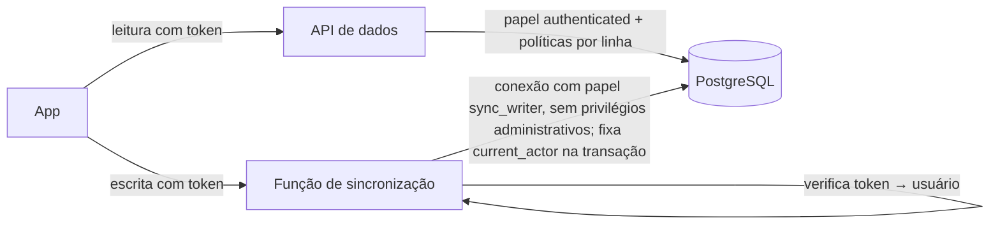

# DAD-05 — Autenticação e Autorização

| Campo | Valor |
|---|---|
| Identificador | DAD-05 |
| Status | **Aprovado** (2026-10-26 — Etapa 4) |
| Etapa | 4 |
| Dono do assunto | Mecanismo de login e sessão, criação do usuário inicial, papéis, permissões, isolamento e adequação da RN-031 ao provedor |
| Dependências | ADR-003, ADR-004, ADR-018, ADR-028, ADR-032, ADR-034, RN-001, RN-002, RN-031..033, RN-040, RN-052, RN-053, DAD-03 |
| Referenciado por | DAD-04, SEG-01, IMP-01, IMP-04 |
| Decisões | ADR-050 (papel de escrita da sincronização), ADR-051 (adequação da RN-031) — aprovadas |
| Última atualização | 2026-10-26 |

## 1. Objetivo

Definir como o usuário se autentica, quanto tempo a sessão dura (inclusive offline), como papéis e permissões são determinados e como o isolamento é garantido no servidor.

## 2. Fatos verificados do provedor (documentação oficial, 2026-10-26)

| Item | Fato | Fonte |
|---|---|---|
| Token de acesso | Expira em 1 hora por padrão | Supabase — sessões |
| Token de renovação | "refresh tokens never expire but can only be used once" | Supabase — sessões |
| Limite de duração/inatividade da sessão | "only available on Pro Plans and up" — **indisponível no gratuito** | Supabase — sessões |
| Tamanho mínimo de senha | Configurável nas opções de autenticação | Supabase — segurança de senhas |
| Proteção contra senhas vazadas | "available on the Pro Plan and above" — **indisponível no gratuito** | Supabase — segurança de senhas |
| Limite de login | Endpoint de token (senha **e** renovação): padrão de 150 requisições a cada 5 minutos, com picos de até 30, **por endereço IP**; personalizável | Supabase — limites de requisições |

Consequências: VH-04 e VH-05 respondidas — a RN-031 aprovada **não** é implementável literalmente no plano gratuito (limite por e-mail e lista de senhas comuns no servidor). Proposta de adequação na ADR-051 (§6).

## 3. Login, sessão e saída

| Ação | Mecanismo | Regras |
|---|---|---|
| Login (API-A01) | E-mail e senha no serviço de autenticação | TELA-001; requer conexão |
| Sessão no aparelho | Tokens guardados pelo cliente de autenticação no armazenamento da origem; o token de acesso é renovado automaticamente quando há conexão | Enquanto houver token de renovação válido, o app abre offline sem login (UX-08 §8.1) |
| Duração | No plano gratuito, a sessão não expira por tempo ou inatividade; termina ao sair, ao trocar a senha (renovação revogada — a confirmar na fundação) ou por revogação no painel | Risco residual: aparelho perdido desbloqueado → mitigação pelo bloqueio do aparelho e saída/revogação remota pelo painel (IMP-04) |
| Token de acesso expirado offline | Execução local continua; o envio aguarda renovação (RN-047) | Não remove dados (RN-052 d) |
| Saída (API-A03) | Encerra a sessão local; fluxo RN-052 | UX-04 §6.1 |
| Troca de senha (API-A04, RF-007) | O app reautentica com a senha atual e só então define a nova | RN-031 (adequada pela ADR-051) |
| Recuperação de senha (PES) | Procedimento operacional pelo painel do provedor (ADR-004) | IMP-04 |

O token de acesso nunca é enviado em URL nem registrado em log. A chave usada para criptografar pendências mantidas (ADR-028 L6) é derivada **no aparelho** da senha digitada; é independente do hash de senha do provedor e nunca sai do aparelho.

## 4. Criação do usuário inicial (PES)

1. O usuário é criado no painel do provedor (ou por script operacional executado localmente com credencial administrativa, nunca no app) — IMP-01.
2. Uma migração/script de inicialização cria o registro em `managers` para esse usuário.
3. No primeiro acesso, `onboarding.complete` (API-002) cria o registro em `students` com `is_self = true` e os dados iniciais.
4. Cadastro público de contas fica **desabilitado** no provedor (ADR-004).

## 5. Papéis e permissões

| Papel | Determinado por | Permite |
|---|---|---|
| Gestão | Existe `managers.user_id = usuário` | Programas, catálogo personalizado, perfil dos seus alunos (RN-002) |
| Aluno | Existe `students.user_id = usuário` | Execução, registros, própria evolução (RN-001) |
| Papel duplo | Ambos (ADR-003) | Alternância de área (RF-005); regras de aluno valem ao agir como aluno (RN-033) |

- Os papéis são calculados no servidor a cada requisição a partir das tabelas; o app só usa a informação para navegação.
- Operações TER (cadastrar outros alunos etc.) são recusadas pelo banco enquanto `ter_enabled = false` (TG-04, RN-040).

### 5.1 Isolamento no servidor (ADR-028 L4, ADR-050)

| Camada | Garantia |
|---|---|
| Papel `authenticated` | Somente **leitura**, filtrada pelas políticas por linha (DAD-03 §7) |
| Papel `anon` | Nenhum acesso a dados |
| Papel `sync_writer` (ADR-050) | Usado **apenas** pela função de sincronização; pode escrever, mas as políticas por linha comparam cada linha com o `current_actor()` fixado pela função a partir do token verificado; não pode ignorar políticas, alterar esquema nem ler tabelas do serviço de autenticação |
| Credencial administrativa | Nunca usada pelo app nem pela função de sincronização; somente em migrações e backup (IMP-01) |
| Testes | Acesso cruzado em todas as leituras e operações (RNF-014, SEG-03); tabela sem política faz o CI falhar |

## 6. Adequação da RN-031 ao provedor (ADR-051 — aprovada)

| Parte da RN-031 aprovada | Possível no plano gratuito? | Proposta |
|---|---|---|
| Mínimo de 10 caracteres | Sim (configuração do provedor) | Configurar 10 no provedor + validar no app |
| Diferente do e-mail | Não no servidor | Validar no app antes de enviar |
| Verificada contra senhas comuns | Não no servidor (recurso pago) | Validar no app contra uma lista de senhas comuns embutida |
| 5 tentativas em 15 min **por e-mail** | Não (limite do provedor é por IP e inclui renovações de sessão) | Usar o limite por IP do provedor (manter o padrão ou reduzir moderadamente, sem prejudicar renovações) + espera progressiva no app após 5 falhas seguidas |

Texto aprovado em 2026-10-26 e aplicado à RN-031: "Senha com no mínimo 10 caracteres (exigido pelo serviço de autenticação); o app recusa senha igual ao e-mail ou presente em lista de senhas comuns. Tentativas de login são limitadas por endereço IP pelo serviço de autenticação; após 5 falhas seguidas, o app impõe espera progressiva antes de nova tentativa." A modalidade TER exigirá reavaliação (proteção no servidor pode requerer plano pago).

## 7. Cabeçalhos e armazenamento

- `Cache-Control: no-store` nas respostas com dados pessoais (API de dados e função de sincronização) — ADR-028 L5.
- Política de segurança de conteúdo (CSP) restritiva no app (domínios do próprio app e do backend), definida em SEG-01, reduzindo o risco de roubo de tokens por scripts injetados.

## Critérios de conclusão

- [x] Login, sessão (inclusive offline), saída, troca e recuperação de senha definidos com base em fatos verificados.
- [x] Papéis, permissões e isolamento no servidor definidos.
- [x] Incompatibilidade da RN-031 identificada e proposta de adequação registrada sem alterar a regra aprovada.
- [x] ADR-050 e ADR-051 aprovadas.
- [x] Aprovação do usuário.

## Referências

- <https://supabase.com/docs/guides/auth/sessions>
- <https://supabase.com/docs/guides/auth/password-security>
- <https://supabase.com/docs/guides/auth/rate-limits>

## Histórico

| Data | Alteração |
|---|---|
| 2026-10-26 | Esqueleto criado. |
| 2026-10-26 | Conteúdo completo (Etapa 4). |
| 2026-10-26 | Aprovado pelo usuário (Etapa 4). |
