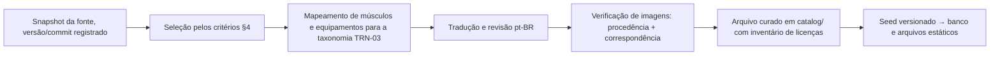

# DAD-06 — Catálogo de Exercícios e Fontes

| Campo | Valor |
|---|---|
| Identificador | DAD-06 |
| Status | **Aprovado** (2026-10-26 — Etapa 4) |
| Etapa | 4 |
| Dono do assunto | Avaliação de fontes, licenças, critérios de curadoria, processo de importação e tradução, inventário de licenças, imagens e placeholders |
| Dependências | ADR-012, RF-030..038, RN-036, RN-037, RNF-027, PRD-08 (REG-12) |
| Referenciado por | TRN-03, DAD-07, ARQ-05, PLN-01 |
| Decisões | ADR-052 (fonte do catálogo e política de imagens) — aprovada |
| Última atualização | 2026-11-04 (versão 1.2) |

## 1. Objetivo

Garantir um catálogo inicial real, variado, em português, com imagens corretas e licenças verificadas (RF-038), sem misturar dados fictícios com reais (RN-037).

## 2. Fontes avaliadas (consulta em 2026-10-26)

| Fonte | Licença declarada | Conteúdo | Pontos de atenção | Avaliação |
|---|---|---|---|---|
| **free-exercise-db** (github.com/yuhonas/free-exercise-db) | **Unlicense** (domínio público declarado); "Open Public Domain Exercise Dataset" | 800+ exercícios em JSON com nome, nível, mecânica, equipamento, músculos primários e secundários, instruções, categoria e imagens | Derivada de "exercises.json" (Ollie Jennings), também sob Unlicense; **a origem das imagens não é informada** em nenhum dos dois repositórios; alguns campos podem ser nulos; textos em inglês | **Recomendada para dados e textos** (com tradução e revisão); **imagens só após comprovação de procedência** |
| wger | Código AGPL 3+; dados iniciais de exercícios sob **CC BY-SA 3.0**; imagens com fontes diversas (ex.: Wikipédia), listadas em arquivos SOURCES | Exercícios multilíngues | CC BY-SA exige atribuição e compartilhamento pela mesma licença do material derivado; licença por imagem a verificar individualmente | Alternativa para itens específicos, com atribuição |
| Conjunto comercial do mesmo autor (wrkout.xyz) | Comercial (uso comercial anunciado) | 10.000+ imagens | Custo — exige aprovação (ADR-016) | Fora do Lançamento 1 |
| APIs comerciais (ex.: ExerciseDB) | Termos comerciais | Dados e GIFs | Custo, termos de uso, dependência em tempo de execução | Descartada |
| Wikimedia Commons | Licenças por arquivo (domínio público, CC BY, CC BY-SA) | Imagens avulsas | Curadoria item a item; atribuição por imagem | Complemento de imagens |
| Imagens próprias | Do usuário/projeto | Fotos/ilustrações feitas para o app | Esforço de produção | Complemento (D5+: imagem própria em exercício personalizado) |

## 3. Política de imagens (ADR-052 — aprovada)

> **Versão 1.2 ([PLN-06](../08-planejamento/06-plano-versao-1-2.md), implementado no local em 2026-11-04):** **a ADR-094 altera os itens 1 e 2 para as fotos do free-exercise-db**: são usadas sem comprovação de origem, com o risco aceito pelo usuário. São 110 de 110 exercícios, com 2 fotos cada, conferidas uma a uma por Claude em folhas de contato; o usuário ainda não as revisou. Os itens 3 a 5 continuam valendo. As fotos são WebP de até 640 px, cerca de 20 KB cada, em `apps/web/public/exercicios/`, e ficam fora do pré-carregamento do service worker. Se uma foto não carregar, o placeholder aparece. Ao abrir para terceiros, REG-12 reavalia o risco.

1. **Nenhuma imagem é publicada sem procedência e licença comprovadas** (RN-036). Uma declaração genérica de licença do repositório não comprova a autoria das imagens.
2. Para as imagens do free-exercise-db: antes de usar, tentar comprovar a origem (contato com os mantenedores; registros no histórico do repositório). Sem comprovação, **não usar**.
3. Enquanto não houver imagem comprovada, o exercício usa o **placeholder** padronizado (RF-034) — o que RF-038 permite.
4. Complementar progressivamente com imagens do Wikimedia Commons (licença por arquivo, atribuição registrada em `exercise_images`) e imagens próprias.
5. Imagem que não corresponda ao exercício é removida, mesmo que licenciada.

**Consequência a decidir por você:** se a procedência das imagens do free-exercise-db não for comprovada, o Lançamento 1 terá parte dos exercícios **sem imagem** (placeholder) até a curadoria progressiva. Alternativa: adquirir conjunto comercial (custo — exige aprovação).

## 4. Critérios de curadoria do catálogo inicial (RF-038)

| Critério | Meta |
|---|---|
| Quantidade | ≥ 80 exercícios ativos no Lançamento 1 (seleção a partir de ~800) |
| Cobertura de grupos musculares | Todos os grupos primários de TRN-03, com ≥ 3 exercícios cada para grupos grandes (peitoral, costas, ombros, quadríceps, posteriores, glúteos) e ≥ 2 para os demais |
| Cobertura de equipamentos | Peso livre (barra, halteres), máquinas, cabos/polias e peso corporal, cada um com ≥ 10 exercícios |
| Níveis | Iniciante, intermediário e avançado representados |
| Alternativas | Para cada exercício de máquina, ao menos uma alternativa com peso livre ou corporal (D4) |
| Textos | Nome em pt-BR usual nas academias brasileiras; instruções traduzidas **e revisadas** (não tradução automática sem revisão); dicas de segurança sem linguagem de prescrição ou diagnóstico (RN-030) |
| Prioridade | Exercícios usados no programa real do usuário entram primeiro |

## 5. Processo de importação

- O snapshot e os arquivos curados ficam no repositório (`catalog/`, ARQ-03); produção nunca consulta a fonte externa.
- Cada exercício importado registra `source_id` e `source_ref`; cada imagem registra `source_id`, licença e atribuição.
- Revisões futuras do catálogo entram como novas migrações de seed (DAD-07), nunca editando dados de produção à mão.
- Dados fictícios só existem em `fixtures/` de teste, marcados como fictícios (RN-037).

## 6. Inventário de licenças

Mantido em `catalog/LICENCAS.md` (gerado a partir de `content_sources` e `exercise_images`) e exibido no app em "Créditos e fonte" (TELA-014). Para conteúdo CC BY ou CC BY-SA, a atribuição exigida aparece junto ao item. A compatibilidade de licenças com eventual uso na modalidade TER será revista no GATE-TER (REG-12).

## 7. Riscos

| Risco | Mitigação |
|---|---|
| Procedência das imagens não comprovada | Placeholder + curadoria progressiva (ADR-052) |
| Textos da fonte com origem incerta | Tradução com reescrita e revisão reduz dependência do texto original; fonte registrada |
| Mapeamento muscular incorreto | Revisão manual na curadoria; correção por RF-032 |
| Esforço de curadoria maior que o previsto | Tarefa própria no plano (PLN-01); começar pelos exercícios do programa real do usuário |

## Referências

- <https://github.com/yuhonas/free-exercise-db>
- <https://github.com/wrkout/exercises.json>
- <https://wger.readthedocs.io/en/latest/>

## Critérios de conclusão

- [x] Fontes avaliadas com licença, conteúdo e riscos.
- [x] Critérios de curadoria, processo de importação e inventário definidos.
- [x] ADR-052 aprovada.
- [x] Aprovação do usuário.

## Histórico

| Data | Alteração |
|---|---|
| 2026-10-26 | Esqueleto criado. |
| 2026-10-26 | Conteúdo completo (Etapa 4). |
| 2026-10-26 | Aprovado pelo usuário (Etapa 4). |
| 2026-11-04 | Versão 1.2: fotos do free-exercise-db (ADR-094). |
