# IMP-02 — Estratégia de Deploy

| Campo | Valor |
|---|---|
| Identificador | IMP-02 |
| Status | **Aprovado** (2026-10-26 — Etapa 6) |
| Etapa | 6 |
| Dono do assunto | Pipeline de CI/CD, ordem de publicação, reversão, atualização do service worker, domínio próprio e migração de origem |
| Dependências | IMP-01, ARQ-02 §8, ARQ-03, DAD-07, UX-08 §9, SEG-03, ADR-035, Q-006 (domínio definitivo antes do uso real — ver GOV-02 §5) |
| Referenciado por | IMP-04, PLN-01 |
| Decisões | ADR-075 (pipeline e ordem de deploy) — aprovada |
| Última atualização | 2026-10-26 |

## 1. Pipeline (ADR-075)

```mermaid
flowchart LR
    PR[Pull request] --> C1[Tipos + lint + varredura de segredos + auditoria de dependências]
    C1 --> C2[Testes de unidade, banco, contrato]
    C2 --> C3[E2E + acessibilidade]
    C3 --> PV[Deploy de pré-visualização → ambiente de desenvolvimento]
    PV --> M[Merge em main]
    M --> P1[Backup de produção imediato]
    P1 --> P2[Migrações em produção]
    P2 --> P3[Deploy da função de sincronização]
    P3 --> P4[Deploy do app estático]
    P4 --> P5[Teste de fumaça em produção]
```

- Deploy em produção só a partir de `main`, pelo CI; nunca manual (exceto procedimentos de IMP-04).
- **Versão 1.2 (V12-10, decisão de 2026-11-06):** desenvolvimento publica sozinho depois do CI verde num envio para `main`, com o mesmo commit testado; produção, só pelo botão "Publicação" em Actions. A publicação também grava os segredos da Workers AI (`CLOUDFLARE_ACCOUNT_ID`, `CLOUDFLARE_AI_TOKEN`) quando existem no ambiente do GitHub; sem eles, a função de IA devolve só o motor (RN-062).
- Ordem justificada: o banco evolui primeiro em modo compatível (expandir/contrair — DAD-07); a função aceita a versão de contrato anterior e a nova; por último o app.
- Teste de fumaça: abrir o app, consultar a saúde do backend, verificar cabeçalhos de segurança.

## 2. Reversão

| Componente | Como reverter |
|---|---|
| App estático | Republicar o deploy anterior pela hospedagem |
| Função de sincronização | Republicar a versão anterior (compatível com o contrato anterior) |
| Banco | Somente para frente: migração corretiva; em último caso, restauração do backup feito no passo P1 (IMP-03) |

## 3. Atualização do app no aparelho

Conforme UX-08 §9: nova versão baixada em segundo plano; aplicada só sem sessão em andamento; migração do banco local preserva a fila. O `index.html` e o service worker são servidos sem cache longo (SEG-01 §5) para que a atualização seja detectada.

## 4. Domínio próprio e migração de origem (ADR-035)

### 4.1 Adotar domínio antes do uso real (recomendado)

1. Registrar o domínio (custo anual — Q-006) e decidir entre subdomínio (CNAME, sem mover DNS) e domínio raiz (exige DNS na Cloudflare) — ARQ-02 HD-06.
2. Adicionar o domínio ao projeto de hospedagem; aguardar o certificado.
3. Atualizar CSP/`connect-src` se necessário e o endereço permitido no provedor.
4. Instalar o app pelo endereço definitivo e só então iniciar o uso real.

### 4.2 Migrar depois do uso real (não transparente)

1. Publicar no novo endereço mantendo o antigo ativo.
2. Liberar, no endereço antigo, o aviso persistente "O app mudou de endereço" com o botão **Ir para o novo endereço** habilitado somente com a fila vazia.
3. No antigo: enviar todas as pendências; pendências mantidas por usuários que saíram exigem entrar e enviá-las antes.
4. No novo: instalar e entrar; os dados sincronizados são baixados.
5. Somente após confirmar fila vazia nos aparelhos em uso, ativar o redirecionamento do endereço antigo (HD-04).
6. Desinstalar o app antigo dos aparelhos.

## Critérios de conclusão

- [x] Pipeline, ordem, reversão, atualização e migração de origem definidos.
- [x] ADR-075 aprovada.
- [x] Aprovação do usuário.

## Histórico

| Data | Alteração |
|---|---|
| 2026-10-26 | Esqueleto criado. |
| 2026-10-26 | Conteúdo completo (Etapa 6). |
| 2026-10-26 | Aprovado pelo usuário (Etapa 6). |
| 2026-11-06 | V12-10: desenvolvimento automático depois do CI verde; segredos da Workers AI na publicação. |
