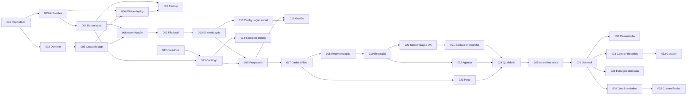

# PLN-01 — Dependências e Ordem de Implementação

| Campo | Valor |
|---|---|
| Identificador | PLN-01 |
| Status | **Aprovado** (2026-10-26 — Etapa 7) |
| Etapa | 7 |
| Dono do assunto | Tarefas de implementação (TAR-###) ordenadas por dependência |
| Dependências | Todas as etapas 1–6 aprovadas |
| Referenciado por | PLN-02, PLN-03, PLN-05 |
| Decisões | ADR-080 (ordem e incrementos) — aprovada |
| Última atualização | 2026-10-26 |

## 1. Regras do plano

1. Nenhuma tarefa começa antes do **Marco de aprovação formal** (GOV-01).
2. Cada tarefa é pequena e verificável; só avança quando sua **condição para avançar** for atendida e o CI estiver verde.
3. Toda tarefa referencia documentos; comportamento sem documento correspondente é proibido (GOV-01 §6).
4. Divergência entre documento e realidade técnica → parar a parte afetada, propor alteração e aguardar aprovação quando houver impacto em escopo, arquitetura, segurança ou regras.
5. **Ações do usuário** são marcadas: Claude não cria contas, não gera nem guarda a chave privada de backup e não opera aparelhos reais.
6. Tamanho relativo: Pequeno (P), Médio (M), Grande (G) — não é estimativa de prazo.

## 2. Grafo de dependências

A curadoria (TAR-012) é trabalho de conteúdo e pode correr em paralelo desde o Marco.

## 3. Tarefas
### TAR-001 — Repositório e ferramentas

| Campo | Conteúdo |
|---|---|
| Incremento | I-1 |
| Objetivo | Criar a base do monorepo com controle de versão, TypeScript estrito, lint, formatação e CI mínimo. |
| Referências | ARQ-03, ARQ-04, ADR-037, ADR-039, VH-10 |
| Pré-requisitos | Aprovação formal da Fase 2 (Marco) |
| Entregáveis | Repositório git com estrutura de ARQ-03; workspace pnpm; configuração TS/ESLint/Prettier; CI com tipos, lint, varredura de segredos e auditoria de dependências; versões exatas fixadas; licenças verificadas (VH-10) registradas em ARQ-02 §9 |
| Critérios de aceite | CA-220, CA-226 |
| Testes | CI executando em PR de exemplo; falha proposital de lint bloqueia |
| Depende de | — |
| Condição para avançar | CI verde em `main`; VH-10 registrada |
| Tamanho | Pequeno |
| Ação do usuário | criar o repositório privado no GitHub (Claude não cria contas) |

### TAR-002 — Pacote de domínio e parâmetros

| Campo | Conteúdo |
|---|---|
| Incremento | I-1 |
| Objetivo | Criar `packages/domain` puro, com esquemas Zod base, módulo de parâmetros (PRD-07 §11) e infraestrutura de testes com metas de cobertura. |
| Referências | ARQ-04 §3, §5, §6; PRD-07 §11; SEG-03 §3 |
| Pré-requisitos | TAR-001 |
| Entregáveis | Pacote com esquemas das entidades de DAD-02, parâmetros versionados, módulo de mensagens pt-BR, utilitários de data/fuso (RN-028) |
| Critérios de aceite | CA-221 |
| Testes | Unidade (≥ 90% no pacote) |
| Depende de | TAR-001 |
| Condição para avançar | Cobertura mínima ativa no CI |
| Tamanho | Pequeno |

### TAR-003 — Ambientes e configuração do provedor

| Campo | Conteúdo |
|---|---|
| Incremento | I-1 |
| Objetivo | Provisionar desenvolvimento e produção conforme IMP-01 e confirmar as verificações pendentes. |
| Referências | IMP-01, ADR-032, ADR-033, ADR-074, VH-03, VH-06, VH-09, VH-11, HD-05 |
| Pré-requisitos | TAR-001 |
| Entregáveis | Projetos Supabase (dev; prod em São Paulo), projeto Cloudflare Pages, segredos no CI; cadastro público desabilitado; senha mínima 10; VH-03/06/09/11 e suporte a HSTS registrados |
| Critérios de aceite | CA-212, CA-223 |
| Testes | Checklist de configuração |
| Depende de | TAR-001 |
| Condição para avançar | Verificações registradas em ARQ-02 §9; divergência relevante → parar e propor ajuste |
| Tamanho | Pequeno |
| Ação do usuário | criar as contas/projetos no Supabase, Cloudflare e GitHub e cadastrar segredos (com orientação passo a passo) |

### TAR-004 — Banco: base, papéis e políticas

| Campo | Conteúdo |
|---|---|
| Incremento | I-1 |
| Objetivo | Criar as migrações base, os papéis `authenticated`/`anon`/`sync_writer`, `current_actor()` e o arcabouço de testes de políticas por linha. |
| Referências | DAD-01..03, DAD-07, ADR-050, VH-12 |
| Pré-requisitos | TAR-003 |
| Entregáveis | Migrações: taxonomias (seed TRN-01/03), `managers`, `students`, `training_profiles`, `rest_settings`, `rest_overrides`, `assessments`, `weight_entries`, `system_settings`; gatilhos TG-03, TG-04, TG-05, TG-08; teste de CI que falha se tabela sem política; VH-12 confirmada |
| Critérios de aceite | CA-214, CA-222, CA-224 |
| Testes | Integração do banco; acesso cruzado; escrita direta recusada |
| Depende de | TAR-003 |
| Condição para avançar | Testes verdes; se VH-12 falhar, parar e propor alternativa (exige aprovação — ADR-050) |
| Tamanho | Médio |

### TAR-005 — Casca do app e componentes base

| Campo | Conteúdo |
|---|---|
| Incremento | I-1 |
| Objetivo | Criar o app React com rotas lógicas, tokens, temas e componentes base acessíveis. |
| Referências | UX-01..03, UX-06, UX-07, ADR-023..026 |
| Pré-requisitos | TAR-002 |
| Entregáveis | Rotas de UX-03 §5; tokens de UX-02 nos dois temas; `AppHeader`, `BottomNav`, `SideRail`, `AreaSwitch`, `Button`, `FormField`, `Stepper`, `Snackbar`, `Dialog`, `Banner`, `EmptyState`, `Skeleton`, `ErrorState`; barreiras de erro (SEG-05 §4); Playwright + axe |
| Critérios de aceite | CA-201, CA-202, CA-203, CA-204, CA-205 |
| Testes | Unidade de componentes; axe; visual em 360/768/1280 |
| Depende de | TAR-002 |
| Condição para avançar | Sem violações axe críticas/sérias |
| Tamanho | Médio |

### TAR-006 — PWA base e publicação

| Campo | Conteúdo |
|---|---|
| Incremento | I-1 |
| Objetivo | Tornar o app instalável e publicável com o pipeline de IMP-02. |
| Referências | RF-090, UX-08 §2–§5, §9; SEG-01 §5; IMP-02; ADR-071, ADR-075 |
| Pré-requisitos | TAR-003, TAR-005 |
| Entregáveis | Manifest e ícones; service worker com pacote em cache; fluxo de atualização (UX-08 §9); `_headers`; TELA-002; deploy de pré-visualização e produção pelo CI; teste de fumaça |
| Critérios de aceite | CA-090, CA-216, CA-219 |
| Testes | E2E de instalabilidade; cabeçalhos; fumaça |
| Depende de | TAR-003, TAR-005 |
| Condição para avançar | Deploy de produção pelo CI funcionando com endereço provisório |
| Tamanho | Médio |

### TAR-007 — Backup, disponibilidade e retenção

| Campo | Conteúdo |
|---|---|
| Incremento | I-1 |
| Objetivo | Implementar backup diário criptografado, verificação de disponibilidade e limpeza de retenção. |
| Referências | IMP-03, SEG-02 §3, SEG-04 §4, ADR-073 |
| Pré-requisitos | TAR-004, TAR-006 |
| Entregáveis | Workflow de backup (`db dump` + `age` + soma de verificação, retenção 35 dias); verificação horária sem consulta ao banco; tarefa diária de limpeza; **1º teste de restauração** no projeto de desenvolvimento |
| Critérios de aceite | CA-209, CA-211 |
| Testes | Restauração com roteiro de IMP-03 §3 |
| Depende de | TAR-004, TAR-006 |
| Condição para avançar | Restauração bem-sucedida registrada |
| Tamanho | Pequeno |
| Ação do usuário | gerar o par de chaves `age`, guardar a chave privada e entregar só a pública |

### TAR-008 — Autenticação e conta básica

| Campo | Conteúdo |
|---|---|
| Incremento | I-2 |
| Objetivo | Login, sessão, troca de senha e inicialização do usuário. |
| Referências | RF-001, RF-002, RF-007, DAD-05, RN-031, ADR-051, IMP-01 §4, TELA-001, TELA-005 |
| Pré-requisitos | TAR-004, TAR-005 |
| Entregáveis | TELA-001; sessão persistente; TELA-005 com validações de RN-031 (lista de senhas comuns, ≠ e-mail) e espera progressiva; script operacional de inicialização (`managers`); logout simples (sem pendências) |
| Critérios de aceite | CA-001, CA-002, CA-007, CA-213 |
| Testes | Unidade (RN-031); E2E de login/logout |
| Depende de | TAR-004, TAR-005 |
| Condição para avançar | CA verdes |
| Tamanho | Pequeno |

### TAR-009 — Banco local, fila de saída e motor de envio

| Campo | Conteúdo |
|---|---|
| Incremento | I-2 |
| Objetivo | Implementar o armazenamento local por usuário e a fila com guardas e classificação de resultados. |
| Referências | ADR-027, ADR-028 L1–L3, RN-042, RN-043, RN-047, RN-051, UX-08 §6, DAD-01 §7 |
| Pré-requisitos | TAR-002, TAR-008 |
| Entregáveis | Banco local por usuário (identificador opaco); fila com dono por operação; envio ordenado com intervalos crescentes; classificação RN-051; pedido de armazenamento persistente; migração versionada do banco local |
| Critérios de aceite | CA-091, CA-102, CA-210 |
| Testes | Unidade; E2E T-PWA-09, T-PWA-15; migração local |
| Depende de | TAR-002, TAR-008 |
| Condição para avançar | Nenhuma operação removida da fila sem confirmação (teste) |
| Tamanho | Grande |

### TAR-010 — Função de sincronização (base)

| Campo | Conteúdo |
|---|---|
| Incremento | I-2 |
| Objetivo | Criar a função de escrita com autenticação, guarda de dono, idempotência, revisões e formato de erro. |
| Referências | DAD-04 §2, §4, §7; ADR-034, ADR-050, ADR-053 |
| Pré-requisitos | TAR-004, TAR-009 |
| Entregáveis | Função com `contract_version`, `current_actor()`, `sync_operations`, conflito por revisão, `OWNER_MISMATCH` + auditoria, `deferred`; operação API-002 (`onboarding.complete`), API-003, API-007 |
| Critérios de aceite | CA-210, CA-214 |
| Testes | Contrato: idempotência (3 reenvios), conflito, dono divergente, NOT_FOUND |
| Depende de | TAR-004, TAR-009 |
| Condição para avançar | Cobertura ≥ 80% na função |
| Tamanho | Grande |

### TAR-011 — Configuração inicial e Conta

| Campo | Conteúdo |
|---|---|
| Incremento | I-2 |
| Objetivo | Primeiro acesso guiado e tela de Conta. |
| Referências | TELA-003, TELA-004, RF-005, RF-009, TRN-01, SEG-01 §6.1 |
| Pré-requisitos | TAR-008, TAR-010 |
| Entregáveis | Assistente de 7 etapas com progresso local; leitura API-R01; Conta com chave de área, aparência e "Sobre e privacidade" |
| Critérios de aceite | CA-005, CA-009, CA-301 |
| Testes | E2E JOR-08 |
| Depende de | TAR-008, TAR-010 |
| Condição para avançar | CA verdes |
| Tamanho | Médio |

### TAR-012 — Curadoria do catálogo (conteúdo)

| Campo | Conteúdo |
|---|---|
| Incremento | I-3 |
| Objetivo | Selecionar, traduzir, revisar e classificar ≥ 80 exercícios com licenças e imagens de procedência comprovada. |
| Referências | DAD-06, TRN-03, ADR-052, RF-038 |
| Pré-requisitos | Marco (pode começar em paralelo a I-1) |
| Entregáveis | Arquivos curados em `catalog/` (nome, instruções e dicas pt-BR, grupos, equipamentos, padrão, marcadores, dificuldade); inventário de licenças; imagens comprovadas ou placeholder; contato com mantenedores sobre procedência |
| Critérios de aceite | CA-038 |
| Testes | Validação automática dos arquivos (esquema, cobertura de §4 de DAD-06) |
| Depende de | — |
| Condição para avançar | Revisão do usuário dos exercícios do seu programa real |
| Tamanho | Grande |
| Ação do usuário | revisar nomes e instruções dos exercícios que você usa |

### TAR-013 — Catálogo no banco e telas

| Campo | Conteúdo |
|---|---|
| Incremento | I-3 |
| Objetivo | Publicar o catálogo e as telas de consulta. |
| Referências | DAD-01..03 (catálogo), API-R04, API-R05, TELA-014, TELA-033, TELA-034, RF-030, RF-031, RF-034 |
| Pré-requisitos | TAR-004, TAR-005, TAR-012 |
| Entregáveis | Migrações do catálogo; seed versionado; imagens estáticas otimizadas (SEG-04); telas de lista, filtro, detalhe e créditos; placeholder |
| Critérios de aceite | CA-030, CA-031, CA-034 |
| Testes | Integração; E2E de busca e detalhe |
| Depende de | TAR-012 |
| Condição para avançar | CA verdes |
| Tamanho | Médio |

### TAR-014 — Exercício personalizado e correção

| Campo | Conteúdo |
|---|---|
| Incremento | I-3 |
| Objetivo | Criar/editar exercícios personalizados e corrigir textos importados. |
| Referências | RF-032, API-020, TELA-036, RN-036, RN-037 |
| Pré-requisitos | TAR-010, TAR-013 |
| Entregáveis | TELA-036; API-020 preservando `original_text` |
| Critérios de aceite | CA-032 |
| Testes | Contrato; E2E |
| Depende de | TAR-013 |
| Condição para avançar | CA verdes |
| Tamanho | Pequeno |

### TAR-015 — Programas no banco e operações

| Campo | Conteúdo |
|---|---|
| Incremento | I-4 |
| Objetivo | Versões imutáveis, rascunho único e publicação atômica. |
| Referências | RF-020, RF-025, RF-027, RF-028, DAD-01 §5, DAD-03 TG-01/02/09, API-016..019, RN-003..005, RN-021, RN-035 |
| Pré-requisitos | TAR-010, TAR-013 |
| Entregáveis | Migrações de programas; gatilhos; operações de rascunho e publicação com lista de pendências |
| Critérios de aceite | CA-020, CA-025, CA-027, CA-028 |
| Testes | Integração (gatilhos); contrato |
| Depende de | TAR-010, TAR-013 |
| Condição para avançar | Testes de imutabilidade verdes |
| Tamanho | Médio |

### TAR-016 — Gestão: programa, editor e perfil

| Campo | Conteúdo |
|---|---|
| Incremento | I-4 |
| Objetivo | Telas de gestão do programa e do perfil de treinamento. |
| Referências | TELA-030..032, TELA-037, TELA-038, RF-012, RF-016, RF-024, API-003, API-004, TG-08 |
| Pré-requisitos | TAR-015, TAR-011 |
| Entregáveis | Editor com salvamento automático e publicação validada; perfil por seções; avaliação |
| Critérios de aceite | CA-012, CA-016, CA-020, CA-024, CA-025, CA-302 |
| Testes | E2E JOR-02 (manual) |
| Depende de | TAR-015 |
| Condição para avançar | CA verdes |
| Tamanho | Grande |

### TAR-017 — Leituras do aluno e disponibilidade offline

| Campo | Conteúdo |
|---|---|
| Incremento | I-5 |
| Objetivo | Baixar e manter os dados de uso offline. |
| Referências | RF-091, RF-092, RF-093, API-R02, R06..R08, R10; UX-08 §6.1–6.2 |
| Pré-requisitos | TAR-009, TAR-015 |
| Entregáveis | Atualização ao abrir/voltar; pré-download das imagens do programa ativo; "Disponível offline · atualizado às …" |
| Critérios de aceite | CA-091, CA-092, CA-093 |
| Testes | E2E com rede desligada após primeiro carregamento |
| Depende de | TAR-009, TAR-015 |
| Condição para avançar | Programa abre offline |
| Tamanho | Médio |

### TAR-018 — Recomendação, descanso e telas de treino

| Campo | Conteúdo |
|---|---|
| Incremento | I-5 |
| Objetivo | Hoje, escolha de treino, lista e detalhe de treino com recomendação determinística. |
| Referências | TRN-04 §4–§5, RN-013, RN-050, RF-050..055, TELA-006, TELA-010..013, API-007 |
| Pré-requisitos | TAR-017 |
| Entregáveis | Função de recomendação no domínio; TELA-006 (padrão 48 h + ajustes por grupo); TELA-010..013 |
| Critérios de aceite | CA-050..055 |
| Testes | Unidade CT-REC-01..07; E2E |
| Depende de | TAR-017 |
| Condição para avançar | CA verdes |
| Tamanho | Grande |

### TAR-019 — Execução do treino

| Campo | Conteúdo |
|---|---|
| Incremento | I-5 |
| Objetivo | Modo foco com registro de séries offline, cronômetro e conclusão. |
| Referências | TELA-015..017, TRN-04 §2–§3, RF-060..063, RF-065..067, API-008..014, TG-06, TG-07 |
| Pré-requisitos | TAR-018 |
| Entregáveis | Migrações de sessões; operações API-008..014; modo foco, `Stepper`, `SetRow`, `RestTimer` por horário de término, desfazer, manter tela ligada quando suportado; pré-preenchimento |
| Critérios de aceite | CA-060..063, CA-065..067, CA-303 |
| Testes | Unidade CT-PRE-01; E2E T-PWA-03, T-PWA-04 |
| Depende de | TAR-018 |
| Condição para avançar | Sessão completa offline sem perda (T-PWA-03) |
| Tamanho | Grande |

### TAR-020 — Sincronização: indicador, pendências e conflitos

| Campo | Conteúdo |
|---|---|
| Incremento | I-5 |
| Objetivo | Interface de estados, tela de sincronização e resolução. |
| Referências | TELA-007, RF-092, RF-100, RN-045, RN-046, RN-051, ADR-022 |
| Pré-requisitos | TAR-019 |
| Entregáveis | `SyncIndicator`; TELA-007 com três grupos; `ConflictCompare`; duplicidade; aviso de pendências antigas |
| Critérios de aceite | CA-092, CA-100, CA-305 |
| Testes | E2E T-PWA-05, 06, 07, 10 |
| Depende de | TAR-019 |
| Condição para avançar | CA verdes |
| Tamanho | Médio |

### TAR-021 — Saída da conta, troca de usuário e criptografia

| Campo | Conteúdo |
|---|---|
| Incremento | I-5 |
| Objetivo | Fluxos de saída com pendências e proteção das pendências mantidas. |
| Referências | RF-002, RF-101..103, RN-052, RN-053, ADR-028 L6, ADR-070, UX-04 §6 |
| Pré-requisitos | TAR-020 |
| Entregáveis | Diálogos de UX-04 §6.1; limpeza RN-052; criptografia PBKDF2/AES-GCM; liberação no login; senha anterior; medição do tempo de derivação |
| Critérios de aceite | CA-002, CA-101, CA-102, CA-103 |
| Testes | E2E T-PWA-11..16 |
| Depende de | TAR-020 |
| Condição para avançar | Tempo de derivação ≤ ~3 s em aparelho modesto ou proposta de ajuste |
| Tamanho | Médio |

### TAR-022 — Agenda e histórico de sessões

| Campo | Conteúdo |
|---|---|
| Incremento | I-6 |
| Objetivo | Agenda mensal, detalhe e edição de sessões. |
| Referências | TELA-018..020, RF-069..072, RN-011, RN-027, RN-029, TRN-04 §6 |
| Pré-requisitos | TAR-019 |
| Entregáveis | Calendário com estados; detalhe; edição/exclusão com janela de 60 dias; concluir sessão abandonada |
| Critérios de aceite | CA-069..072, CA-304 |
| Testes | Unidade (presença, planejado); E2E JOR-04 |
| Depende de | TAR-019 |
| Condição para avançar | CA verdes |
| Tamanho | Médio |

### TAR-023 — Peso e gráfico

| Campo | Conteúdo |
|---|---|
| Incremento | I-6 |
| Objetivo | Registro, exclusão e gráfico de peso. |
| Referências | TELA-021, TELA-022, RF-080, RF-081, API-005, API-006, TRN-05 §2 |
| Pré-requisitos | TAR-017 |
| Entregáveis | Folha de registro; lista com exclusão (UXP-01); gráfico com linhas de referência e tabela alternativa |
| Critérios de aceite | CA-080, CA-081 |
| Testes | Unidade CT-EVO; E2E |
| Depende de | TAR-017 |
| Condição para avançar | CA verdes |
| Tamanho | Pequeno |

### TAR-024 — Qualidade transversal

| Campo | Conteúdo |
|---|---|
| Incremento | I-7 |
| Objetivo | Fechar requisitos não funcionais antes do lançamento. |
| Referências | SEG-01, SEG-03, SEG-04, SEG-05, RNF-001..028 |
| Pré-requisitos | TAR-021, TAR-022, TAR-023 |
| Entregáveis | API-030 (diagnóstico); auditoria de cobertura de acesso cruzado em 100% das tabelas; Lighthouse; axe em todas as telas `ESS`; revisão de logs sem dados pessoais |
| Critérios de aceite | CA-201..228 |
| Testes | Suítes completas |
| Depende de | TAR-021..023 |
| Condição para avançar | Todas as metas de SEG-03/SEG-04 atingidas |
| Tamanho | Médio |

### TAR-025 — Verificação em aparelhos reais

| Campo | Conteúdo |
|---|---|
| Incremento | I-7 |
| Objetivo | Validar VP-01..VP-11 e os cenários manuais de T-PWA. |
| Referências | UX-08 §5.1, §10; SEG-03 §5 |
| Pré-requisitos | TAR-024 |
| Entregáveis | Resultados registrados em UX-08 §5.1; ajustes de comportamento quando uma hipótese falhar |
| Critérios de aceite | CA-218, CA-228 |
| Testes | Roteiro manual |
| Depende de | TAR-024 |
| Condição para avançar | Nenhum ponto de alto risco (VP-03, 04, 10) sem mitigação |
| Tamanho | Médio |
| Ação do usuário | executar o roteiro no seu celular (e, se possível, num segundo aparelho) |

### TAR-026 — Preparação e entrada em uso real

| Campo | Conteúdo |
|---|---|
| Incremento | I-7 |
| Objetivo | Ativar a produção e iniciar o uso real do Lançamento 1. |
| Referências | IMP-01 §4, IMP-02 §4.1, IMP-03 §4, PRD-04 §6.1, ADR-023, Q-006 |
| Pré-requisitos | TAR-025 |
| Entregáveis | Decisão do endereço definitivo (Q-006) e verificação de marca do nome; teste de restauração pré-uso; inicialização do usuário em produção; checklist de PRD-04 §6.1 |
| Critérios de aceite | CA-300, CA-301, CA-302, CA-303, CA-304, CA-305 |
| Testes | Fumaça em produção |
| Depende de | TAR-025 |
| Condição para avançar | Lançamento 1 entregue; 2 semanas de uso real sem perda (critério de PRD-04 §6.1) acompanhadas |
| Tamanho | Pequeno |
| Ação do usuário | decidir o endereço definitivo, criar o usuário de produção e instalar o app |

### TAR-030 — Reavaliação

| Campo | Conteúdo |
|---|---|
| Incremento | D1 |
| Objetivo | Lembrete, fluxo de reavaliação e adiamento. |
| Referências | TRN-05 §3, RF-083..085, TELA-050, API-004, API-022, API-R09 |
| Pré-requisitos | Lançamento 1 em uso |
| Entregáveis | Banner; assistente de 4 etapas; adiamento por data |
| Critérios de aceite | CA-083, CA-084, CA-085, CA-306 |
| Testes | Unidade CT-REA; E2E JOR-05 |
| Depende de | TAR-026 |
| Condição para avançar | Disponível até 30 dias após o início do uso real |
| Tamanho | Médio |

### TAR-031 — Contraindicações no catálogo

| Campo | Conteúdo |
|---|---|
| Incremento | D2 |
| Objetivo | Associar contraindicações explícitas (RF-035) e revisar marcadores. |
| Referências | RF-035, TRN-03 §5 |
| Pré-requisitos | TAR-026 |
| Entregáveis | Contraindicações em `exercise_contraindications`; edição em TELA-036 |
| Critérios de aceite | CA-035 |
| Testes | Integração |
| Depende de | TAR-026 |
| Condição para avançar | CA verdes |
| Tamanho | Pequeno |

### TAR-032 — Gerador automático

| Campo | Conteúdo |
|---|---|
| Incremento | D2 |
| Objetivo | Motor determinístico e tela de geração. |
| Referências | TRN-02, RF-021..023, TELA-051, API-016 |
| Pré-requisitos | TAR-031 |
| Entregáveis | Motor no domínio; relatório; TELA-051 integrada ao editor |
| Critérios de aceite | CA-021..023 |
| Testes | Unidade CT-GER-01..08 |
| Depende de | TAR-031 |
| Condição para avançar | CA verdes; revisão do resultado pelo usuário com seu próprio perfil |
| Tamanho | Grande |

### TAR-033 — Evolução ampliada

| Campo | Conteúdo |
|---|---|
| Incremento | D3 |
| Objetivo | Histórico por exercício, metas, medidas e avaliações. |
| Referências | RF-017, RF-073, RF-082, RF-088, TELA-052..055, API-024, API-R08, API-R09, API-R11, API-R12 |
| Pré-requisitos | TAR-026 |
| Entregáveis | Telas e leituras correspondentes |
| Critérios de aceite | CA-017, CA-073, CA-082, CA-088 |
| Testes | Unidade; E2E |
| Depende de | TAR-026 |
| Condição para avançar | CA verdes |
| Tamanho | Médio |

### TAR-034 — Gestão e qualidade de dados

| Campo | Conteúdo |
|---|---|
| Incremento | D4 |
| Objetivo | Consolidação, versões, alternativas, desativação e sinalizações. |
| Referências | RF-015, RF-018, RF-026, RF-033, RF-036, RF-086, RF-087, TELA-056, API-021, API-023 |
| Pré-requisitos | TAR-026 |
| Entregáveis | Elementos de UX-05 §6 e TELA-056 |
| Critérios de aceite | CA-015, CA-018, CA-026, CA-033, CA-036, CA-086, CA-087 |
| Testes | Unidade; E2E |
| Depende de | TAR-026 |
| Condição para avançar | CA verdes |
| Tamanho | Médio |

### TAR-035 — Conveniências

| Campo | Conteúdo |
|---|---|
| Incremento | D5 |
| Objetivo | Substituir exercício na sessão, registrar treino passado e exportar dados. |
| Referências | RF-064, RF-068, RF-095, TELA-057..059, API-015, API-031 |
| Pré-requisitos | TAR-034 (alternativas) |
| Entregáveis | Telas e operações correspondentes |
| Critérios de aceite | CA-064, CA-068, CA-095 |
| Testes | Contrato; E2E |
| Depende de | TAR-034 |
| Condição para avançar | CA verdes |
| Tamanho | Médio |

## 4. Cobertura

Todo RF `ESS` e `DES` aparece em ao menos uma tarefa (verificação automática registrada em GOV-02). Requisitos `FUT` e da modalidade TER não têm tarefa (bloqueados — PRD-04 §4).

## Critérios de conclusão

- [x] Tarefas pequenas, ordenadas por dependência, com todos os campos exigidos pelo prompt mestre.
- [x] Ações do usuário identificadas.
- [x] ADR-080 aprovada.
- [x] Aprovação do usuário.

## Histórico

| Data | Alteração |
|---|---|
| 2026-10-26 | Esqueleto criado. |
| 2026-10-26 | Conteúdo completo (Etapa 7). |
| 2026-10-26 | Aprovado pelo usuário (Etapa 7). |
| 2026-10-26 | Correção da auditoria final (Etapa 8): referências a API-024, API-R09, API-R11 e API-R12 em TAR-030 e TAR-033. |
