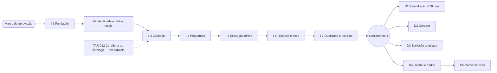

# PLN-02 — Plano de Entrega por Fases

| Campo | Valor |
|---|---|
| Identificador | PLN-02 |
| Status | **Aprovado** (2026-10-26 — Etapa 7) |
| Etapa | 7 |
| Dono do assunto | Agrupamento das tarefas em incrementos entregáveis, demonstrações e critérios de saída |
| Dependências | PLN-01, PRD-04, PLN-03 |
| Referenciado por | PLN-05, GOV-02 |
| Decisões | ADR-080 (ordem e incrementos) — aprovada |
| Última atualização | 2026-11-04 (versão 1.2) |

## 1. Visão geral

## 2. Incrementos do Lançamento 1

| Incremento | Tarefas | O que você poderá ver ao final | Critério de saída |
|---|---|---|---|
| I-1 Fundação | TAR-001..007 | App vazio instalável no endereço provisório; CI, backup e restauração funcionando | CA-090, 201..205, 209, 211, 212, 214, 216, 219..224, 226 verdes; VH-03/06/09..12 registradas |
| I-2 Identidade e dados locais | TAR-008..011 | Login, configuração inicial e Conta; fila local e sincronização básica | CA-001, 002, 005, 007, 009, 091 (parcial), 102, 210 (parcial), 301 |
| I-3 Catálogo | TAR-012..014 | Catálogo curado com busca, detalhe, créditos e exercícios próprios | CA-030..032, 034, 038 |
| I-4 Programas | TAR-015..016 | Montar, editar e publicar seu programa; perfil e avaliação | CA-012, 016, 020, 024, 025, 027, 028, 302 |
| I-5 Execução offline | TAR-017..021 | Treinar de verdade na academia, inclusive sem internet; sincronização e saída seguras | CA-050..055, 060..063, 065..067, 091..093, 100..103, 303, 305 |
| I-6 Histórico e peso | TAR-022..023 | Agenda, histórico de sessões, peso e gráfico | CA-069..072, 080, 081, 304 |
| I-7 Qualidade e uso real | TAR-024..026 | Produção ativa no endereço definitivo; início do uso real | CA-201..228 completos; CA-300 |

Ao final de cada incremento: demonstração para você, atualização de GOV-02 e registro de pendências. Um incremento só começa quando o anterior cumpre o critério de saída (ou você autoriza explicitamente prosseguir com pendências registradas).

## 2A. Versão 1.2 (ADR-096)

Por decisão do usuário, a versão 1.2 ([PLN-06](06-plano-versao-1-2.md)) vem **antes** da publicação em produção do Lançamento 1. D1 e D2 entram nela. Critério de saída: CA-401..409.

## 3. Incrementos desejáveis (após o Lançamento 1)

| Incremento | Tarefas | Prazo/condição | Critério de saída |
|---|---|---|---|
| D1 Reavaliação | TAR-030 | Até 30 dias após o início do uso real | CA-083..085, 306 |
| D2 Gerador | TAR-031, TAR-032 | Após D1 | CA-021..023, 035 |
| D3 Evolução ampliada | TAR-033 | Após D1 | CA-017, 073, 082, 088 |
| D4 Gestão e dados | TAR-034 | Após D1 | CA-015, 018, 026, 033, 036, 086, 087 |
| D5 Conveniências | TAR-035 | Após D4 | CA-064, 068, 095 |

A ordem D2–D5 pode ser trocada por você após o uso real, sem alterar requisitos.

## 4. Caminho crítico e paralelismo

- Caminho crítico do Lançamento 1: TAR-001 → 003 → 004 → 008 → 009 → 010 → 015 → 017 → 018 → 019 → 020 → 021 → 024 → 025 → 026.
- Em paralelo: TAR-012 (curadoria) desde o Marco; TAR-005/006 junto com TAR-003/004; TAR-022 e TAR-023 depois de TAR-019/017.

## Critérios de conclusão

- [x] Incrementos com tarefas, resultado visível e critério de saída.
- [x] ADR-080 aprovada.
- [x] Aprovação do usuário.

## Histórico

| Data | Alteração |
|---|---|
| 2026-10-26 | Esqueleto criado. |
| 2026-10-26 | Conteúdo completo (Etapa 7). |
| 2026-10-26 | Aprovado pelo usuário (Etapa 7). |
| 2026-11-04 | Versão 1.2 antes da publicação (ADR-096). |
