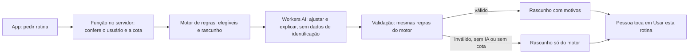

# PLN-06 — Plano da versão 1.2

| Campo | Valor |
|---|---|
| Identificador | PLN-06 (PR-PROD-02 em GOV-02 §4.3) |
| Status | **Decisões aprovadas item a item** (§7A; ADR-093..096). Documentação atualizada a pedido do usuário em 2026-11-04. **Ainda não implementado** |
| Etapa | 9 |
| Dono do assunto | Escopo, ordem e riscos da versão 1.2: design, imagens, geração e acompanhamento por IA, separação entre "Meu treino" e Gestão, vários alunos |
| Dependências | PRD-08 (GATE-TER), PRD-09, TRN-02, DAD-06, ADR-006, ADR-016, ADR-018, ADR-052, RN-007..009, RN-036, RN-040, SEG-04 §2 |
| Data | 2026-11-04 |

## 1. Objetivo e ponto de partida

Tornar o app mais automático e mais bonito: a pessoa informa seus dados, a IA monta a rotina e a acompanha durante a meta.

**Numeração:** "1.0" é o Lançamento 1 de PLN-02. A 1.2 reúne os incrementos D1 e D2 e itens novos.

**Ordem (ADR-096):** a 1.2 vem antes de publicar em produção, por decisão do usuário. Em 2026-11-04, app e função de produção respondem 404; TAR-025 (aparelhos) e TAR-026 (uso real) vêm depois da 1.2.

## 2. Um gestor pode criar um treino para vários alunos?

**Hoje não, e o comportamento observado no teste é o esperado.** Três coisas impedem:

| Barreira | Onde | O que faz |
|---|---|---|
| Regra de negócio | RN-040 | Com o GATE-TER fechado, cada gestor tem um único aluno: ele mesmo |
| Servidor | `ter_enabled = false` (TG-04) | Recusa cadastrar outros alunos, mesmo que a interface tente |
| Modelo do programa | `programs.student_id` | Cada programa pertence a um aluno; não existe "modelo" reutilizável. RF-011 e RF-029 estão como `FUT` |

Tecnicamente é viável: a arquitetura foi feita para vários alunos (ADR-002). O bloqueio é **legal, de propósito** (ADR-018; PRD-09 §4). Ele só cai com o GATE-TER completo e nova ADR (RN-041).

**Decisão da discussão:** fica para depois da 1.2, junto com a consulta jurídica. Quando vier, cada aluno recebe sua própria cópia em rascunho, com restrições reavaliadas (RN-008), nunca o mesmo treino compartilhado.

## 3. Escopo proposto

### 3.1 Design (TAR-V12-01, V12-02)

Observado na tela de login: nome em texto, dois campos e um botão no terço superior; o resto da tela fica vazio; não há logotipo, imagem nem frase sobre o produto. Funciona e passa em acessibilidade, mas não dá identidade.

- **Direção:** manter "Grafite e lima" (UX-02), evoluindo a execução. **Login: direção Anilha**, escolhida pelo usuário.
- **Login:** logotipo com o "F", frase curta do que o app faz, composição que ocupe a tela, e no computador um painel lateral com a marca. O texto "Esqueceu a senha?" fala em "responsável pela instalação" e precisa ser reescrito.
- **Telas principais:** Hoje, Treino, Execução, Evolução, com mais hierarquia, cartões e estados vazios com ilustração.
- **Forma de trabalho:** duas ou três direções visuais do login para escolher **antes** de programar. Depois, aplicar às demais telas.
- **Limites:** contraste, alvos e testes de acessibilidade continuam valendo (CA-201..203). O JS inicial tem só ~5 KB de folga no orçamento, então nada de biblioteca nova de componentes no carregamento inicial; arte em SVG e CSS.

### 3.2 Imagens dos exercícios (TAR-V12-03)

Hoje **nenhum** dos 110 exercícios tem imagem: todos usam o placeholder, porque a ADR-052 exige procedência comprovada (RN-036), e a origem das imagens do free-exercise-db não foi comprovada.

| Opção | Custo | Qualidade e risco | Avaliação |
|---|---|---|---|
| **A. Mapa muscular próprio em SVG** | Grátis | Mostra os músculos trabalhados, em todos os exercícios; não mostra o movimento | **Recomendada como base**: sem risco de licença |
| **B. Ilustrações geradas por IA** (Workers AI: Flux) | Grátis até a cota; estimativa de ~40 neurônios por imagem | Pode desenhar o movimento errado, o que é perigoso aqui. Exige revisão de cada imagem e confirmar termos | **Testar em 10 exercícios** antes de decidir |
| C. wger e Wikimedia Commons | Grátis | Licença por arquivo, atribuição, possível compartilhamento pela mesma licença (CC BY-SA); estilos diferentes | Complemento, item a item |
| D. Free-exercise-db | Grátis | Depende de comprovar a origem; contato ainda em aberto | Só com comprovação (ADR-052) |
| E. Conjunto comercial licenciado | Pago | Estilo uniforme e licença clara | Exige exceção à ADR-016 |

**Decisão da discussão:** fotos do free-exercise-db nos 110 exercícios (opção D, sem comprovação de origem, com o risco aceito pelo usuário; altera ADR-052 e RN-036), revisando se cada foto corresponde ao exercício. O mapa muscular (A) fica como complemento opcional. Técnica: WebP otimizado, fora do pré-carregamento do service worker, em cache sob demanda (UX-08 §6.1).

### 3.3 "Meu treino", Gestão e modos (TAR-V12-04)

Hoje a pessoa alterna entre duas áreas, e a Gestão expõe o editor completo, o que confunde quem só quer treinar.

| Modo | Para quem | Como funciona |
|---|---|---|
| **Automático (padrão)** | Quem só quer treinar | Configuração inicial → rotina proposta → "Usar esta rotina". Sem área de Gestão visível; aba **Meu plano** com rotina, motivos e "gerar outra" |
| **Manual** | Quem quer controlar | Editor atual, em Gestão. A IA vira assistente, propondo ajustes |
| Profissional | **Fora da 1.2** | Lista de alunos, modelos e frequência (RF-010, RF-011, RF-029, RF-040) ficam para depois da consulta jurídica |

Muda UX-03 e UX-05, e RF-005 (alternância de área).

### 3.4 Geração de treinos por IA (TAR-V12-05..08)

**Ênfase em músculo ou área (novo):** a pessoa pode pedir mais foco, por exemplo em glúteos ou ombros. O motor aumenta o volume nesses grupos, dentro dos limites de TRN-02, e a IA explica a escolha. Altera TRN-02 e o perfil (TRN-01, DAD-02).

**Pré-requisitos já planejados:** TAR-031 (contraindicações no catálogo) e TAR-032 (motor de regras, TRN-02). Sem contraindicações, nem as regras nem a IA conseguem excluir com segurança um exercício por lesão.

**Regras:**

- A IA escolhe só entre exercícios elegíveis, por identificador; nunca publica (RN-009).
- Dados enviados, escolhidos pelo usuário em 2026-11-04: objetivo, experiência, dias, tempo, equipamentos, faixa de idade, **ênfase em músculo ou área**, histórico de treinos, peso e meta, categorias de restrição e **observações das sessões**. Nunca nome, e-mail ou identificador. As observações são texto livre e podem conter dados de saúde ou de identificação; o usuário escolheu enviá-las contra a recomendação, valendo só para a própria conta e a rever antes de terceiros (REG-15).
- Saída em JSON é sempre validada, porque o modelo não garante o formato.
- Chave só nos segredos da função; limite por usuário e controle da cota diária.
- O aviso de RN-030 aparece junto da rotina.

**Modelo (estimativa para ~6 mil tokens de entrada e ~1,5 mil de saída; a cota é de 10.000 neurônios por dia):**

| Modelo | Neurônios por geração | Gerações por dia |
|---|---|---|
| `gemma-4-26b-a4b-it` | ~96 | ~100 |
| `qwen3-30b-a3b-fp8` | ~74 | ~135 |
| `gpt-oss-20b` | ~150 | ~65 |
| `llama-3.3-70b-instruct-fp8-fast` | ~467 | ~20 |

Os valores são contas sobre a tabela de preços; precisam de medição. A escolha sai da **prova de qualidade** (V12-05): 20 perfis fictícios, avaliando em português, formato, respeito às restrições, equilíbrio do treino e custo. Se nenhum modelo gratuito passar, o usuário decide entre pagar ou manter só as regras.

**Limitações conhecidas do Workers AI:** a página de limites não informa onde o processamento ocorre (REG-06), e a documentação de uso de dados não fala em revisão humana. Confirmar antes de usar com terceiros.

### 3.5 Acompanhamento por IA (TAR-V12-09)

- **As regras calculam os fatos:** frequência, séries, progressão, tempo até a meta, peso, reavaliação (TAR-030, TAR-033).
- **A IA escreve o resumo** semanal e sugere ajustes, em linguagem simples, sem inventar números. Gerado ao abrir o app, no máximo uma vez por semana; sem conexão, mostra só os fatos.
- **Mudanças no programa são só propostas:** viram novo rascunho, aceito com um toque (RN-009).
- **Sem sugestão de carga na 1.2** (TRN-02 §1; RN-026), conforme a discussão. **Motivação e hábitos** ficam dentro do app, sem notificações.
- **Limite:** não é orientação médica. Dor ou condição de saúde leva ao texto de procurar um profissional (RN-030).

### 3.6 Robustez (TAR-V12-10)

Desenvolvimento automático com produção em um clique (já combinado), testes da IA com casos fixos, alerta de cota, registro sem dados pessoais (SEG-04), e o motor funcionando sozinho quando a IA falhar. Também reduzir a verificação de hora em hora, para caber nos minutos gratuitos do GitHub (VH-09).

## 4. Tarefas e ordem

| Tarefa | Conteúdo | Depende de | Tamanho |
|---|---|---|---|
| — | Publicar 1.0, TAR-025, TAR-026 | V12-* (decisão: depois da 1.2) | Depois |
| V12-01 | Direções visuais do login; escolha do usuário | — | **Feito:** direção Anilha |
| V12-02 | Novo login; design das telas principais | V12-01 | Grande. **Login feito** (2026-11-04); telas principais a fazer |
| V12-03 | Fotos nos 110 exercícios, otimizadas e conferidas | Alteração da ADR-052 | Médio |
| V12-04 | Modos Automático e Manual; aba Meu plano | V12-08 | Médio |
| V12-05 | Prova de qualidade da IA | Token da Cloudflare | Pequeno |
| V12-06 | TAR-031: contraindicações | — | Médio |
| V12-07 | TAR-032: motor de regras | V12-06 | Grande |
| V12-08 | IA sobre o motor: função, validação, cota, tela de geração | V12-05, V12-07 | Grande |
| V12-09 | Reavaliação (TAR-030) e acompanhamento por IA | V12-08 | Grande |
| V12-10 | Robustez e automação | — | Pequeno |

**Em paralelo:** V12-01/02 e V12-05..08 não dependem um do outro. A sequência sugerida entrega valor visível cedo (login) enquanto o motor é construído.

**Fora da 1.2:** vários alunos e abrir para outras pessoas (depende da consulta jurídica); sugestão de carga; notificações; conversa livre com a IA; pagamentos; aplicativo nativo.

## 5. Riscos

| Risco | Consequência | Medida |
|---|---|---|
| Rotina errada para alguém com lesão | Dano físico | Motor e validação decidem; IA nunca passa por cima; aviso; revisão de um profissional antes de terceiros |
| Qualidade do modelo gratuito em português | Texto ruim ou treino fraco | Prova de qualidade antes de construir; só as regras como alternativa |
| Cota gratuita ou mudança de preços | IA para de responder | Motor sozinho; limite por usuário; consumo registrado em `ai_usage` |
| Foto não corresponde ao exercício, ou reclamação de direitos sobre as fotos | Execução incorreta; remover fotos | Conferência item a item; risco aceito (ADR-094); placeholder como alternativa |
| Observações enviadas à IA contêm dados de saúde ou de identificação | Exposição a terceiro | Só o próprio usuário na 1.2; provedor diz não treinar nem guardar; revisto antes de terceiros (REG-15) |
| Uso real adiado (ADR-096) | Melhorias sem aprendizado de uso | Testes no `forja-dev`; publicar a 1.0 continua possível a qualquer momento |
| Questão legal com terceiros | Impede a abertura | Fora da 1.2; consulta antes (PRD-09) |
| Escopo grande | Atraso | Entrega em partes; cada tarefa é aproveitável sozinha |

## 6. Documentos alterados

ADR-006 e FUT-01 (IA deixa de ser futuro), ARQ-05 (nova integração), ADR-052 e RN-036 (imagens), TRN-02 (IA e carga), UX-03, UX-04, UX-05 e UX-02 (modos e design), RF-005, RF-021, RF-034, PLN-01 e PLN-02, SEG-02 e SEG-04 (dados enviados à IA), ADR-016 (se houver custo).

## 7. Decisões

Registradas em §7A e nas ADR-093 a ADR-096.

## 7A. Discussão com o usuário (2026-11-04)

Respostas dadas na discussão; o escopo como um todo **ainda não foi aprovado**.

| Tema | Resposta | Efeito |
|---|---|---|
| Imagens | "Usar para todos": fotos do free-exercise-db | Risco aceito pelo usuário: o repositório se declara Unlicense, mas não informa a origem das fotos. Exige alterar ADR-052 e RN-036. Cobertura conferida: 110 de 110 exercícios, 2 fotos cada, cerca de 70 KB por foto antes de otimizar. Revisar se a foto corresponde ao exercício (ADR-052 item 5). REG-12 continua a verificar ao abrir para terceiros |
| Público | "Alguns conhecidos", mas GATE-TER "Deixar para depois" | **A 1.2 fica só para o usuário.** V12-11 (vários alunos) e o modo Profissional saem da 1.2 |
| Palavra final | "Pessoa, com um toque" | RN-009 mantida |
| Acompanhamento | Resumo semanal, ajuste da rotina, motivação e hábitos | Sem sugestão de carga: TRN-02 §1 não muda. Motivação só dentro do app; notificações seguem fora |
| Design | "Quero ver opções" | Protótipos do login antes de programar (V12-01) |
| Ordem | "1.2 antes de publicar" | Produção e uso real ficam depois da 1.2; até lá, testes só no `forja-dev`, com dados fictícios |
| Login | "gostei da opção B" | Direção Anilha (UX-02 §2.3), com anilha realista |
| Documentação | "atualizar a documentação toda" | Feita em 2026-11-04 |
| IA | "Sim, Workers AI" | **Workers AI em produção, sem Ollama**, com o provedor trocável no código. Sobre o Ollama: neste computador (Intel UHD, 16 GB, i5-13420H) um modelo de 7–8B em CPU rende cerca de 2 a 6 tokens por segundo, segundo guia da comunidade, ou seja, minutos por geração. Para produção exigiria máquina sempre ligada |
| IA sem qualidade | "Só as regras" | Sem custo: o motor segue sozinho se nenhum modelo gratuito passar |
| Modo Manual | "Manter como opção" | Automático por padrão; editor em lugar discreto |
| Login | "Marca e frase curta" | Logotipo e frase; cadastro público segue fechado |
| Dados para a IA | Histórico, peso e meta, restrições, observações, e **ênfase em músculo ou área** (sugerida pelo usuário) | Ver §3.4. Observações enviadas por decisão do usuário, contra a recomendação |

## 8. Fontes

- [Workers AI: preços](https://developers.cloudflare.com/workers-ai/platform/pricing/)
- [Workers AI: limites](https://developers.cloudflare.com/workers-ai/platform/limits/)
- [Workers AI: uso de dados](https://developers.cloudflare.com/workers-ai/platform/data-usage/)
- [Workers AI: modo JSON](https://developers.cloudflare.com/workers-ai/features/json-mode/)
- [wger: documentação](https://wger.readthedocs.io/)

## Histórico

| Data | Alteração |
|---|---|
| 2026-11-04 | Criação como proposta, a pedido do usuário. |
| 2026-11-04 | §7A: respostas da discussão com o usuário; escopo revisado. |
| 2026-11-04 | Decisões aprovadas item a item; documentação atualizada; login Anilha. |
| 2026-11-04 | Login na direção Anilha implementado (parte de V12-02). |
